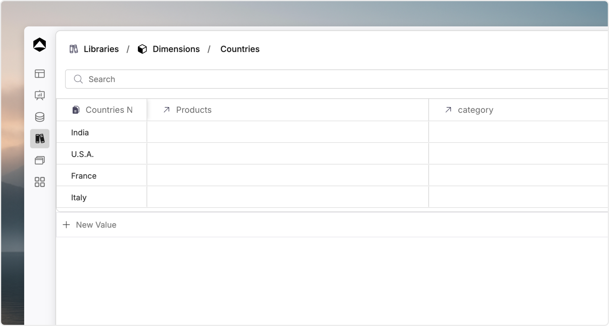

# Oculon docs writing

This repo is the Oculon product documentation, built with Mintlify. Pages are MDX with YAML frontmatter; navigation lives in `docs.json`. The canonical content is under `concepts/`. `docs-new/` and `support-docs/` are legacy sources that are being migrated and redirected — read them for facts, but write new or updated content in `concepts/`.

Readers are finance and planning people building models. They want to understand how a feature behaves and what to do next, quickly. Every rule below serves that: consistent terms so they can search and cross-reference, short sentences so they can scan, and no claims about features that don't exist.

## Workflow

1. **Find the right home.** Look at the target module folder in `concepts/` and its overview page (e.g. `concepts/data-and-structure/dimensions.mdx`). Read one or two sibling pages so your page matches their depth and tone.
2. **Check facts against existing docs.** Use `concepts/core-concepts/glossary.mdx` for term definitions and grep `concepts/` for how a feature is already described. If the legacy docs and the new docs disagree, prefer `concepts/`. If you can't confirm a capability, don't document it — flag it to the user instead (see Content boundaries).
3. **Write the page** using the structure below.
4. **Wire it up.** Add the page path (no `.mdx` extension) to the right group in `docs.json`, add a card or row to the module overview page if siblings have one, and link to it from related pages. If the page replaces a legacy path, add a `redirects` entry in `docs.json`.
5. **Verify.** Run `python3 -c "import json;json.load(open('docs.json'))"` after editing `docs.json` (a parse error takes the whole preview down with a 500). Then run `npx mint broken-links` and fix anything your change introduced.

## Page structure

Frontmatter — every concepts page has `title`, `description`, and `icon`. Add `sidebarTitle` when the title is long or repeats the module name (e.g. title "Dimension values", sidebarTitle "Values").

```mdx
---
title: Dimension values
description: Understand dimension values and how they define the categories your variables, views, and boards can use.
icon: list
sidebarTitle: Values
---
```

- `title`: sentence case, names the concept (not "How to…" unless it's a task page).
- `description`: one sentence, starts with a verb ("Understand…", "Learn how…", "Create…"), says what the reader gets.
- `icon`: a current **Lucide** icon name (the site sets `"icons": {"library": "lucide"}`), consistent with siblings. Every nav page needs one, and so does every `<Card>`. Mintlify renders an unknown name as a blank space, and Lucide has renamed many older names — use `circle-question-mark` not `circle-help`, `triangle-alert` (Mintlify's set doesn't have the newer `triangle-exclamation-point`), `settings` not `gear`, `clock-fading` not `history` (newer names such as `rotate-ccw-clock` may render blank in Mintlify's bundled icon set). Font Awesome names such as `cube` or `sitemap` don't work either. Check names at lucide.dev/icons, or run `python3 .claude/skills/oculon-docs-writing/scripts/check_icons.py`.

Body pattern used across `concepts/`:

1. **Opening paragraph** (no heading) — one to three sentences defining the concept, with a concrete example.
2. **Screenshot** in a `<Frame>` when a UI exists (see Images).
3. **`##` sections** answering what it is, why it matters, how it works, when to use or change it. Keep sections short; prefer bullets for lists of behaviors.
4. **`## Related`** — a bullet list of 2–5 links to sibling or adjacent pages.

Module overview pages (e.g. `dimensions.mdx`) use an intro, a screenshot, then `## In this section` with `<Columns cols={2}>` of `<Card title icon href>` entries — one per child page, each with a one-line summary.

Links are root-relative without extensions: `[Dimension values](/concepts/data-and-structure/dimensions/dimension-values)`.

## Terminology

Use these exact terms. Consistency matters because readers search for them and because several look similar but mean different things.

| Use | Not | Notes |
| --- | --- | --- |
| **Last actual date** | actuals cutoff, actuals date, close date, LAD | The model setting splitting actual from planned periods. Capitalize as shown. |
| **actual formula** / **planned formula** | historical formula, forecast formula, actuals logic | How a variable calculates on each side of the Last actual date. |
| **relative time** | dynamic dates, rolling periods | For formula references like `This month`, `Previous month`, `Last 12 months`, and relative column labels like `Month 1`. There are no quarter references in the formula editor. |
| **time rollups** | — | *Which* lower-level periods belong together (months into a quarter, quarters into a year). |
| **time aggregation** | — | *What value* represents that grouped result (the variable's aggregation setting: **Sum**, **Average**, **Initial**, or **Final**). Never use it interchangeably with time rollups. |
| **Transactions** | Databases | Source records. "Databases" is the legacy name; mention "(formerly Databases)" at most once per page where helpful. |
| `monthly`, `quarterly`, `yearly` | daily, weekly, custom periods | The only time granularities to describe. |

For any other product term, match `concepts/core-concepts/glossary.mdx`. If a term isn't there and you introduce one, say so in your summary to the user.

## Style

- **Second person, active voice.** "You set the Last actual date in model settings," not "The Last actual date is set by the user."
- **One idea per sentence.** Split sentences joined by "and" or "which" when each half is its own point.
- **Sentence case headings.** "Keep values stable", not "Keep Values Stable".
- **Bold UI elements** the reader clicks or reads on screen: Click **Settings**, open the **Dimensions** tab.
- **Code formatting** for file names, commands, paths, formula syntax, and literal values: `Region`, `this month`, `docs.json`.
- **Explain, don't sell.** Avoid "powerful", "seamless", "easily". State what happens.
- Prefer concrete examples (a `Region` dimension with `EMEA` and `APAC`) over abstract descriptions.

## Images

Wrap screenshots in `<Frame>` with a short caption and descriptive alt text. Alt text should say what the image shows so someone who can't see it gets the same information — not just repeat the caption.

```mdx
<Frame caption="Dimension values for a Countries dimension">
  
</Frame>
```

Bad alt: `"screenshot"`, `"Dimensions"`. Only reference images that exist under `images/`; if a screenshot is needed but missing, leave a `{/* TODO: screenshot of … */}` comment and tell the user.

### Framed screenshots

Product screenshots sit on a branded background. Build them with `scripts/frame_screenshot.py`, never by hand:

- Pin the app window to **one** corner of the 5226 × 3252 canvas (top-left, top-right, bottom-left, or bottom-right), with 236 px of background on the side and 288 px on the top or bottom. Only one window corner may show. If two corners show, the zoom is too low.
- Zoom to the focus area: the highlighted region, open menu, or popup the page is about. Pass it with `--focus X0 Y0 X1 Y1` in source pixels. The script fits it with a 150 px margin, up to 2.0×, and picks the nearest corner. Override with `--corner` if needed.
- Menus and popups must never be clipped. Leave out unrelated rows at the bottom.
- Rotate backgrounds `bg - 1` … `bg -5` in order across a series (`--index N`) and log which background each image used.
- Raw captures live in `images/Start here /` in the user's checkout; save outputs to `images/start-here/<kebab-name>.png`. Some captures have a dark strip along the top. Crop it before framing.
- Check every output visually before you place it.

Other components in use: `<Note>` for important caveats (sparingly), `<Columns>` + `<Card>` for overview navigation. Don't introduce new component types without a reason.

## Content boundaries

- **Don't document unsupported or unconfirmed capabilities** — in particular daily, weekly, or custom/fiscal calendar time behavior. If source material mentions them, leave them out and tell the user what you omitted and why. A wrong claim in docs costs more than a missing one.
- **Don't copy competitor docs.** You may use them to decide which topics to cover or how to structure a page, but write every sentence fresh in Oculon's terms.
- Don't document internal or unreleased features you find in legacy material unless the user confirms they ship.
- **Hidden and deferred items live in `docs-backlog.md`** (repo root, excluded via `.mintignore`). When you hide a page, remove it from `docs.json`, add it to `.mintignore`, remove inbound links, repoint its redirects, and log all of that in the backlog table so it can be restored. When you leave out a feature you found in the app, add it to the deferred list there.

## Before you finish

Quick self-check on the page you wrote:

- Frontmatter has title, description, icon (and sidebarTitle if needed)
- Terms match the table above; no "Databases", "actuals cutoff", "daily", "weekly"
- Headings are sentence case; UI elements bold; literals in code
- Every image has a `<Frame>`, caption, and descriptive alt
- Page is in `docs.json`, linked from its overview and a `## Related` list
- `docs.json` parses, `mint broken-links` shows nothing new from your change, and `scripts/check_icons.py` passes
