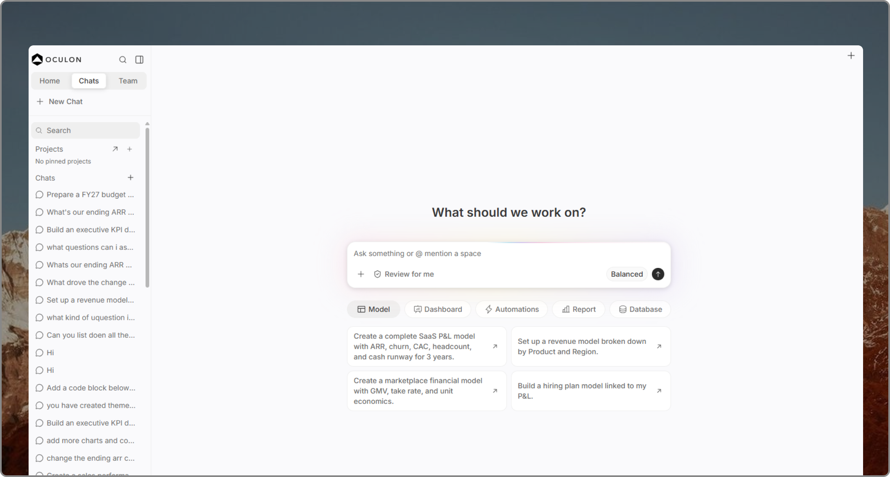

The AI assistant is Oculon's built-in chat. Ask it about your models, boards, and Transactions, or ask it to make changes for you, such as adding variables, building a chart, or drafting a board narrative.

The assistant works inside your workspace. It can only see and change resources you already have access to.

<Frame>
  <video
    autoPlay
    muted
    loop
    playsInline
    className="w-full aspect-video"
    src="/videos/ai-and-agents/ai-assistant-chat.mp4"
    aria-label="The AI assistant open beside the SaaS P&L model. The user asks for ending ARR, cash balance, and runway, and the assistant answers with figures read from the model."
  />
</Frame>

## Open the assistant

The quickest way in is the keyboard. Press `Cmd + J` on Mac or `Ctrl + J` on Windows. If the assistant is already open, the shortcut focuses the composer.

You can also select **Start a new chat** at the bottom right of the screen. To start a New chat or reopen an earlier one, open the **Chats** tab in the sidebar. For a full-screen conversation, go to **Chat**.

<Frame>
  
</Frame>

## Choose a layout

Use **Change Layout** in the chat header to switch between three layouts. Sidebar keeps the chat beside a model or board you have open. Floating gives you a movable window over your work. Full screen works best for long conversations, plans, and goals.

## How the assistant works

You send a message in a chat mode, such as Ask or Agent. The assistant then reads the resources it needs, such as models, boards, or Transactions you can access.

In Agent or Goal mode, it goes on to make the changes you asked for. If a change needs your approval, it pauses and asks you first. Afterward, you can undo the changes from the chat or restore an earlier checkpoint. See [Approvals and checkpoints](/concepts/ai-and-agents/ai-assistant/approvals-and-checkpoints).

## AI assistant vs custom agents

Use the assistant for ad hoc questions and changes. It runs when you send a message, works with your own permissions, and replies in chat.

Use a [custom agent](/concepts/ai-and-agents/custom-agents) for one repeatable job. An agent runs when you run it or when its schedule fires, uses only the resources shared with it, and reports through runs and [Feed](/concepts/ai-and-agents/feed) updates.

## In this section

<Columns cols={2}>
  <Card title="Chat basics" icon="message-circle" href="/concepts/ai-and-agents/ai-assistant/chat-basics">
    Modes, models, @mentions, attachments, and chat history.
  </Card>
  <Card title="What the assistant can do" icon="list-checks" href="/concepts/ai-and-agents/ai-assistant/what-the-assistant-can-do">
    The modeling, reporting, and data work the assistant can take on.
  </Card>
  <Card title="Plan mode" icon="list" href="/concepts/ai-and-agents/ai-assistant/plan-mode">
    Review an editable plan before the assistant builds.
  </Card>
  <Card title="Goal mode" icon="target" href="/concepts/ai-and-agents/ai-assistant/goal-mode">
    Let the assistant work across many steps until a goal is done.
  </Card>
  <Card title="Approvals and checkpoints" icon="shield-check" href="/concepts/ai-and-agents/ai-assistant/approvals-and-checkpoints">
    Control what needs your approval and roll back changes.
  </Card>
  <Card title="Modeling with AI" icon="brain" href="/concepts/ai-and-agents/ai-assistant/modeling-with-ai">
    Build and explain models with example prompts.
  </Card>
  <Card title="Reporting with AI" icon="chart-line" href="/concepts/ai-and-agents/ai-assistant/reporting-with-ai">
    Build boards and explain variances with example prompts.
  </Card>
  <Card title="Skills" icon="book-open" href="/concepts/ai-and-agents/skills">
    Reuse instructions for tasks you run often.
  </Card>
</Columns>

## Keep judgment in the loop

Treat assistant output as a draft. Before you rely on a result, confirm the scenario, time range, aggregation, and business rules it used.

To see what AI remembers about you, read [Knowledge and memory](/concepts/ai-and-agents/knowledge-and-memory). Admins set workspace-wide AI defaults in [Workspace AI](/concepts/ai-and-agents/workspace-ai).
