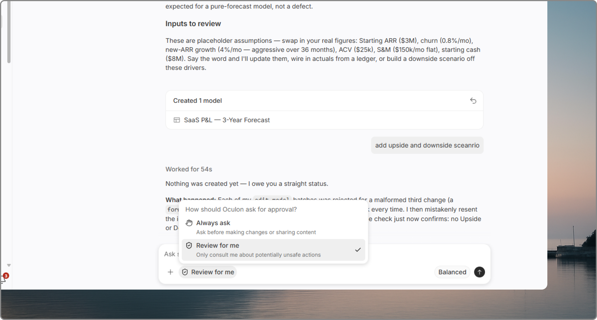

The AI assistant can change your models, boards, and Transactions. Approvals let you review a change before it happens. Checkpoints let you undo changes after they happen.

## Choose how the assistant asks for approval

Open the composer's approval menu, How should Oculon ask for approval?, and pick an option.

<Frame>
  
</Frame>

With Always ask, the assistant asks before it makes any change or shares content. With Review for me, it only asks about potentially unsafe actions. Review for me is the default.

Some high-risk actions always need your approval, even with Review for me. These include deleting a model, variable, dimension, Transactions table, board, card, or comment. They also include granting or revoking access, and merging scenarios.

## Review a change

When a change needs approval, a Needs your approval box appears above the composer. Read the summary of the proposed change. Large changes are marked Large change.

If several changes are waiting, move between them with Previous approval and Next approval, or select Review all.

Select **Approve** to make the change, or Reject to skip it. To redirect the assistant, type in Tell Oculon what to do instead.

### Remember a decision

For some kinds of changes, you can turn on **Remember** ("Don't ask again for this"). The assistant then auto-approves matching changes for the rest of this chat. The setting doesn't carry over to other chats.

## Undo changes

When the assistant changes something, a changes card appears in the chat. It lists what changed, with Open for each item.

Select **Undo** to reverse the changes from that turn. Undo also reverses edits to Transactions rows and board cards, but keeps edits other people made in the meantime. If only some changes can be reversed, Oculon shows Partly undone.

## Restore a checkpoint

Oculon saves a checkpoint after each turn that changes your work. To go back further than one turn, find that turn and select **Restore Checkpoint**, then Rollback here. Oculon saves your current state first, but a rollback can't be reversed with Undo.

## Approvals for custom agents

Custom agents that run on a schedule ask for approval in [Feed](/concepts/ai-and-agents/feed) instead of in chat. See [Access and approvals](/concepts/ai-and-agents/custom-agents/agent-permissions).
