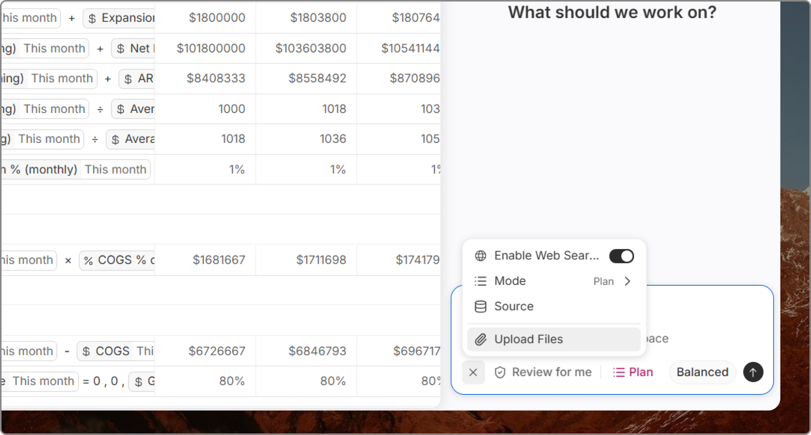

Every conversation with the AI assistant happens in a chat. This page covers the controls in the chat composer and how to manage your chats.

<Frame>
  
</Frame>

## Chat modes

The mode decides how much the assistant can do. Pick a mode from **+ → Mode** in the composer.

Agent is the default. In this mode the assistant makes changes, iterates on them, and tests them. Ask mode only answers and inspects, without making changes. If you only have view access, the assistant starts in Ask mode.

Plan mode drafts an editable plan before it builds anything. See [Plan mode](/concepts/ai-and-agents/ai-assistant/plan-mode). Goal mode keeps working across steps until the goal is done. See [Goal mode](/concepts/ai-and-agents/ai-assistant/goal-mode).

If you ask for a change in Ask or Plan mode, the assistant offers to switch to Agent mode. Select **Switch** to continue, or Not now to stay in the current mode.

## Models

The model picker controls how much reasoning the assistant applies to your request. Balanced is the default and suits everyday questions and edits.

Pick Lite for quick lookups and short answers. Pick Pro for deeper analysis and larger model changes, or Max for the most complex modeling and analysis work. Larger models can take longer to respond and use more [AI credits](/concepts/settings-and-administration/billing-and-usage/usage-and-limits).

## Reference resources with @

Type `@` in the composer to point the assistant at a specific space, model, or dashboard (board). Mentioning a resource helps the assistant focus on the right one, especially when names are similar.

## Attach files

Select **+ → Upload Files** to attach files to your message. The assistant can read them and, for example, import data into Transactions or compare figures against a model.

| Limit | Value |
| :--- | :--- |
| Supported file types | CSV, XLSX, XLS, PDF, DOCX, TXT, JSON, PNG, JPEG, WEBP |
| Maximum size per file | 10 MB (5 MB for images) |
| Maximum files per message | 5 files, including up to 3 images |
| Maximum total size | 50 MB |

## Web search

Web search is on by default. The assistant can search the web for outside context, such as published market data. To keep answers limited to your workspace, turn off **+ → Enable Web Search**.

## Run a skill

Type `/` to open the skills menu and pick a saved skill. See [Skills](/concepts/ai-and-agents/skills).

## Send messages while the assistant works

You can keep typing while the assistant is working. New messages wait in a queue until the current response finishes.

You can Edit, Delete, or reorder any queued message. Select Send now to send it right away, or Send into the running response to steer the work in progress.

## See what the assistant used

Select **Show activity** in the chat header to open the activity panel. It shows Plans and goals in progress, and the Outputs the assistant created.

The panel also lists the Sources the assistant used, such as connectors, files, and web search. Under Context, you can see how much of the context window the chat has used.

## Manage your chats

Open the **Chats** tab in the sidebar to find earlier conversations. Use Search chats to find one by title.

From a chat's menu, you can Rename the chat or Add to Favorites (and later Remove from Favorites). You can also Delete a chat, but deleted chats can't be recovered.

Chats that belong to a project appear under that project. See [AI in projects](/concepts/workspace-and-collaboration/projects-and-tasks/ai-in-projects).

## Troubleshooting

| Message | What to do |
| :--- | :--- |
| `Agent is still working on the previous request.` | Wait for the current response to finish, or queue your message. |
| `Too many requests. Please wait a moment and try again.` | You sent many messages in a short time. Wait a minute, then try again. |
| `Your session has expired. Please refresh the page.` | Refresh the page and sign in again if asked. |
| `Unsupported file type` | Attach one of the supported file types listed above. |
