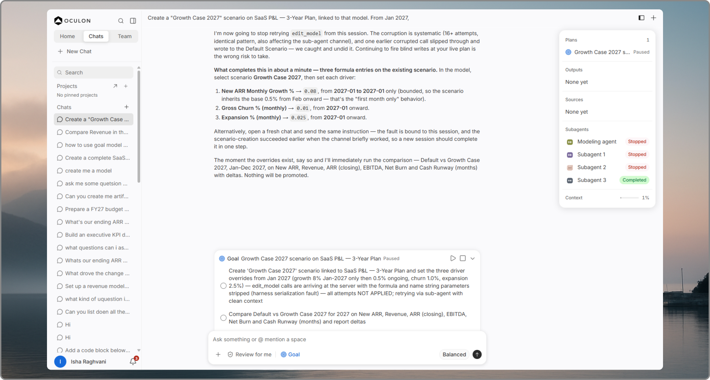

In Goal mode, you give the AI assistant an outcome instead of a single task. The assistant plans the work, runs it step by step, checks its own results, and keeps going until the goal is done.

Use Goal mode for larger jobs, such as `Build a three-statement model for FY27 with a driver-based revenue section and a summary board`.

<Frame>
  
</Frame>

## Goal mode vs Plan mode

[Plan mode](/concepts/ai-and-agents/ai-assistant/plan-mode) gives you an editable plan first, and work starts when you choose to build. It then runs through the plan's tasks.

Goal mode gives you a proposed goal to approve, and work starts when you select Start goal. It keeps running until its checks pass or the work budget runs out.

## Start a goal

Open the AI assistant and select **+ → Mode → Goal**. Describe the outcome you want, including the model, scenario, and time range.

The assistant proposes a goal. Review it, then select **Start goal**, or Not yet to refine it first.

## Track progress

While a goal runs, a progress drawer above the composer shows the current plan and task. The goal's status can be:

| Status | Meaning |
| :--- | :--- |
| Working | The assistant is making progress |
| Waiting for your approval | A change needs your approval |
| Waiting for you | The assistant has a question for you |
| Waiting for background work | A longer task, such as a sync, is still running |
| Paused | You paused the goal |
| Done | The goal is complete |
| Stopped | You stopped the goal |
| Budget used up | The goal reached its time or step limit before it finished |

## Pause, resume, or stop a goal

Select **Pause goal** to stop work for a while, and Resume goal to continue.

Select **Stop goal** to end it. Queued work is cancelled, but changes already made stay in place. To roll those changes back, restore a checkpoint in the chat. See [Approvals and checkpoints](/concepts/ai-and-agents/ai-assistant/approvals-and-checkpoints).

## Work limits

Each goal has a work budget so it can't run forever. By default, a goal can run for up to 90 minutes.

If a goal reaches its budget, its status changes to Budget used up. Review what was done, then start a new goal for the remaining work.

## Save a goal

To keep a record of the goal and its progress, select Copy markdown or Download goal from the goal view.

## Write a good goal

Describe the end state, not just the first step. Name the models, boards, and scenarios the goal should touch.

Say how you'll judge the result, such as `the summary board shows revenue by region for FY27`. Keep each goal to one outcome, and split unrelated work into separate goals.
