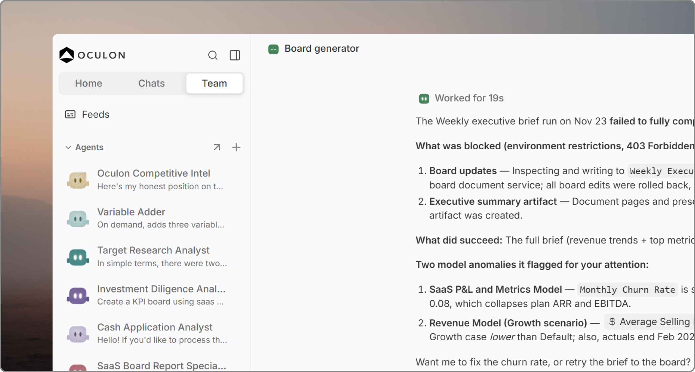

A custom agent is an AI teammate you set up once for a repeatable job, such as a weekly cash report or a month-end variance review. It runs on its own schedule, with the same instructions and the same access every time, and reports back when it's done.

<Frame>
  
</Frame>

## How an agent works

An agent has a profile with its instructions, personality, and model. You share the models, Transactions, and files it needs, and it keeps its own memory as it works.

The work itself lives in routines. Each routine is one task, such as a weekly bookings summary, and a trigger such as a schedule decides when it runs. Every time a routine runs, the result shows up in the agent's chat, its Activity, and [Feed](/concepts/ai-and-agents/feed). If a run needs to make an important change, it waits for a person to approve it first.

## What agents are good for

Agents work best for jobs that repeat on a schedule. An agent can summarize last week's bookings against plan every Monday, check the P&L model for formula errors at month-end, flag large variances between Budget and Actuals each morning, or refresh the Pipeline table from a CRM export.

Keep each agent to one job. A `Close checker` and a `Cash reporter` are easier to trust than one agent that does both.

## Where agents live

Select **Team** in the sidebar to see your agents. The list includes agents you created and agents shared with you.

Open an agent to chat with it. Each agent has one ongoing chat where you can ask questions, give feedback, or ask it to change its own setup, such as `Add a routine that runs every Friday at 16:00`. Routine results appear in the same chat as run cards.

The gear icon opens Agent info, where you edit the agent's profile and routines. The clock icon opens Activity, where you see every run. Each agent also has an `@handle` and an avatar color, so it's easy to spot in Feed and chat.

{/* ASSET TODO: An agent's page showing its chat with a routine run card and the Agent info panel open. Replace placeholder with /images/ai-and-agents/agent-workspace.png */}
<Frame>
  
</Frame>

## Agents and the AI assistant

Use the [AI assistant](/concepts/ai-and-agents/ai-assistant) for one-off questions and changes. It works with your own permissions and replies in chat.

Use a custom agent when the same job comes up again and again. An agent runs on a schedule, uses only the resources shared with it, follows saved instructions, and asks for approval in Feed instead of in chat.

## Who can do what

What you can do with an agent depends on the access level it was shared with you at. See [Access and approvals](/concepts/ai-and-agents/custom-agents/agent-permissions). Admins can also limit who creates, shares, and uses agents in [Workspace AI](/concepts/ai-and-agents/workspace-ai).

An agent never borrows its creator's access. It only sees what has been shared with it.

## Pause or delete an agent

To stop an agent without losing its setup, pause its routines. See [Routines and triggers](/concepts/ai-and-agents/custom-agents/agent-routines).

To copy an agent, open **More actions → Duplicate**. To remove it for good, open **More actions → Delete**. Deleting an agent removes its tasks and access, and only people with Full access can do it.

## Next steps

<Columns cols={2}>
  <Card title="Create an agent" icon="circle-plus" href="/concepts/ai-and-agents/custom-agents/create-a-custom-agent">
    Set up the profile, knowledge, and memory.
  </Card>
  <Card title="Routines and triggers" icon="repeat" href="/concepts/ai-and-agents/custom-agents/agent-routines">
    Give the agent tasks and a schedule.
  </Card>
  <Card title="Access and approvals" icon="shield-check" href="/concepts/ai-and-agents/custom-agents/agent-permissions">
    Control who uses the agent and what it can change.
  </Card>
  <Card title="Runs and activity" icon="activity" href="/concepts/ai-and-agents/custom-agents/agent-activity-and-runs">
    Track every run, its result, and its cost.
  </Card>
</Columns>
