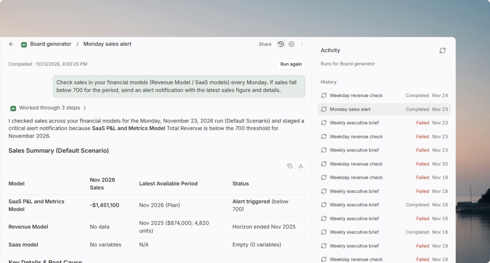

Every time a routine runs, Oculon records a run. Use Activity to follow runs as they happen, and Insights to see how an agent performs over time.

## Activity

Open the agent and select **Activity** (the clock icon). Runs that need your approval or input appear under Needs attention, runs that are still going appear under In progress, and finished runs appear under History.

<Frame>
  
</Frame>

| Status | Meaning |
| :--- | :--- |
| Queued | Waiting to start |
| Running | The agent is working |
| Needs approval | A change is waiting for a person to approve it |
| Needs input | The agent has a question |
| Completed | The run finished |
| Failed | The run stopped because of an error |
| Cancelled | The run was cancelled |

## Open a run

Select a run to see what the agent read, what it changed, and its final result. If the run needs approval, approve or reject the change. If it needs input, answer the agent's question. Either way, the run then continues.

If you can edit the agent, you can also select **Stop** to end a run that's still going, or **Run again** to repeat a finished one.

## When a run fails

Open the run and read the error. Most failures come from lost access or from instructions that no longer match the model, such as a renamed variable or scenario. Fix the cause, then select **Run now** on the routine to check that it works.

## Insights

Insights shows how often an agent runs, how often its runs complete, and how many AI credits it uses.

To open it, select **More actions** (the three dots) on the agent, then **View insights**. It opens next to the agent's chat and covers the last 30 days by default. You can switch to 7 or 90 days. All times are in UTC.

<Frame>
  <video
    autoPlay
    muted
    loop
    playsInline
    className="w-full aspect-video"
    src="/videos/ai-and-agents/agent-insights.mp4"
    aria-label="Insights open next to the Board generator agent's chat. It shows the summary tiles, then scrolls through the charts, Runs by automation, and the runs table, and switches the date range from Last 30 days to Last 7 days."
  />
</Frame>

At the top, four tiles summarize the period: Total credits, Total runs, Completion rate, and Avg. active users, which counts the people who started the agent's work themselves.

Below them, charts show runs, credits, active users, and completion rate day by day, along with the average credits per run. Runs by automation shows which of the agent's routines ran most.

At the bottom, Runs lists every run in the period with when it started, whether it was scheduled or manual, its status, and its credits. Select a run to open it.

A falling completion rate usually means a routine's instructions no longer match the model. A jump in credits can mean a routine runs too often or on too large a model.

## Keep agents healthy

Check Insights every month or so for failed runs and rising credit use. Update the agent when a model or process changes, and pause agents nobody uses. To get alerts when a run fails or an agent needs you, set them up under **My Account → Notifications → AI & Agents**. See [Notifications](/concepts/settings-and-administration/personal-settings/notifications).
