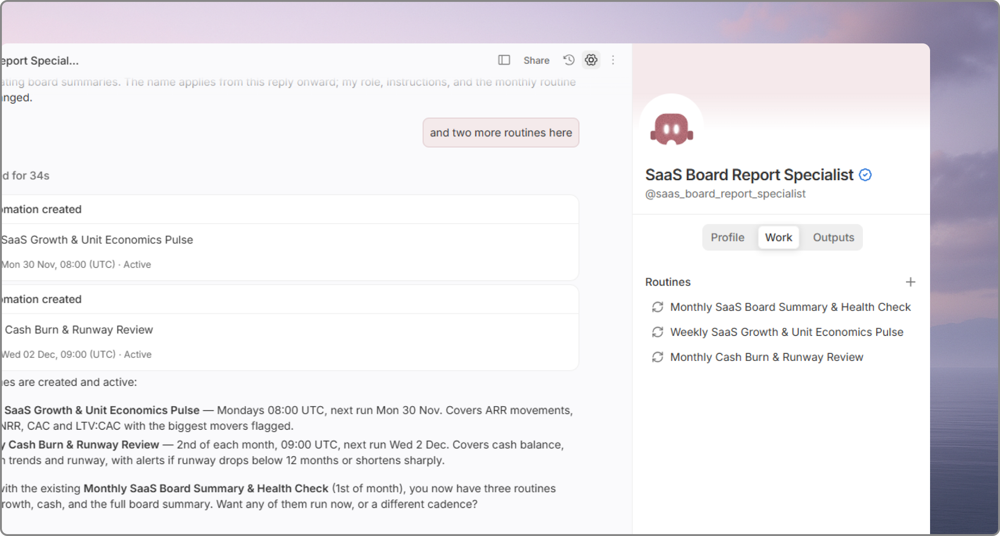
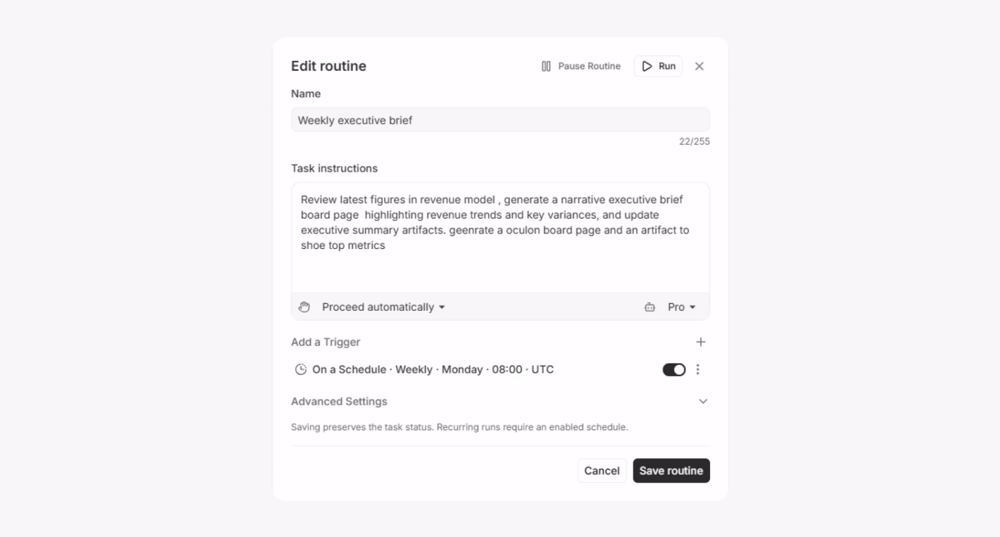
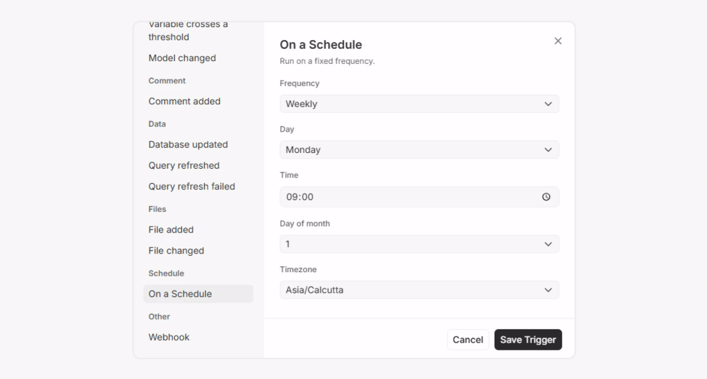
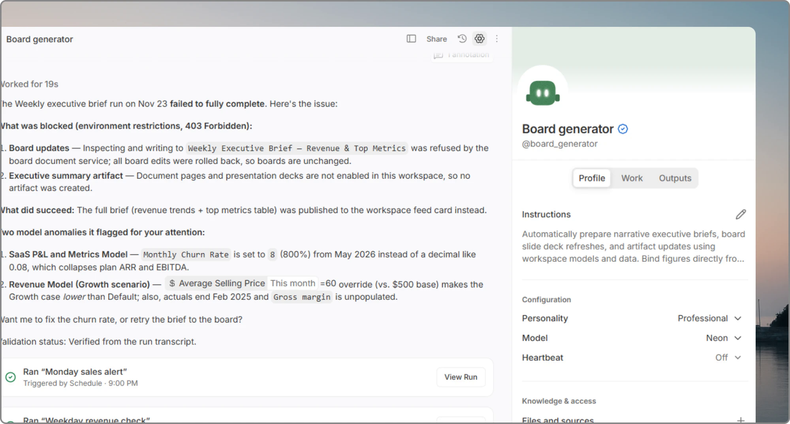

A routine is one task an agent owns, such as a weekly report or a monthly close check. A trigger decides when that routine runs. An agent can have several routines, each with its own instructions, approval rule, and schedule.

Find an agent's routines in **Agent info → Work**.

<Frame>
  
</Frame>

## Add a routine

Select **Add routine**. The quickest way is Use AI: describe when the routine should run and what Oculon should do, and the agent sets it up for you. You can also ask in the agent's chat, as in the screenshot above.

To set it up yourself, choose Create manually:

1. Give the routine a Name, such as `Prepare quarterly financial forecasts`.
2. Write the Task instructions: the steps for this task and what a good result looks like.
3. Choose Request review or Proceed automatically. See [Access and approvals](/concepts/ai-and-agents/custom-agents/agent-permissions).
4. Choose a model, then select **Add a Trigger** to set when it runs.
5. Select Save routine.

New routines are saved Paused. Activate a routine before its triggers can run it.

<Frame>
  
</Frame>

Good task instructions describe one task with a clear finish line. Name the model, scenario, and time range, say what the output should look like, and say what to do when nothing needs attention.

## Choose a trigger

Open the routine and select **Add a Trigger**. Pick a trigger from the list, or search for one, fill in its details, and select Save Trigger.

<Frame>
  
</Frame>

{/* PRODUCT CHECK: The client offers only triggers the server fires (routineTriggerCatalog.ts), and the server dispatches change triggers in dispatch_resource_changes. Confirm comment, query refresh, and webhook triggers end to end before publishing. */}

On a Schedule runs the routine at a set time. Pick how often (daily, weekdays, weekly, monthly, or quarterly), the day, the time, and the time zone. This is the most common trigger for reports and close checks.

A routine can also run when something changes in your workspace. Variable crosses a threshold runs when a variable in a model goes above or below a value you set, in the current period or any period. Model changed runs when a model's values change, when the model itself is edited, or on any change.

For Transactions, Database updated runs when rows change or when columns and settings change. Query refreshed and Query refresh failed run after a table's source query finishes or fails. Comment added runs when someone comments on a model, Transactions table, board, folder, or teamspace. File added and File changed watch a folder, teamspace, or board for new or edited items.

Webhook lets another tool start the routine by calling its URL. When you save the routine, Oculon creates the URL and a secret token. The token is shown only once, so copy it then. To get a new one, remove the trigger and add it again.

Changes an agent makes during its own runs never start other routines, so routines can't set each other off in a loop.

A routine can have more than one trigger, and it runs when any of them fires. Schedule routines after your data syncs finish, in your team's time zone. For close-related runs, check that the model's Last actual date is up to date first.

## Test and run

Select **Run now** to run a routine immediately. Run it once before you activate the schedule, check the result against the source data, and try an edge case, such as a missing month of actuals.

To stop a routine without deleting it, switch it from Active to Paused.

Each time a routine runs, a run card appears in the agent's chat showing the routine, what triggered it, and when. Select View Run to open it.

<Frame>
  
</Frame>
