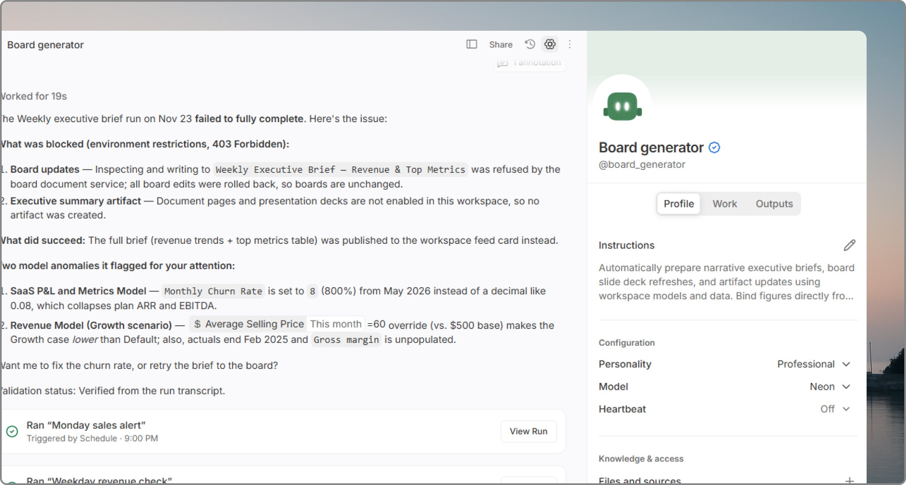
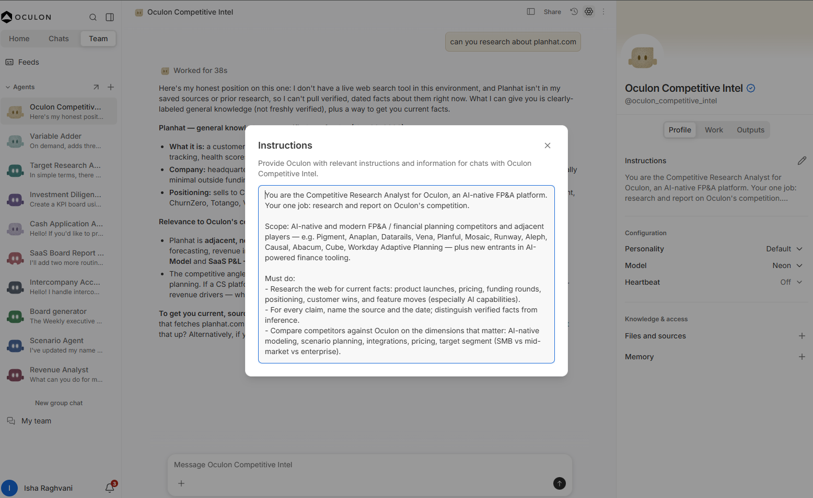

A new agent does nothing until you give it instructions, share what it needs, and add a routine. This page covers the first two. For routines, see [Routines and triggers](/concepts/ai-and-agents/custom-agents/agent-routines).

## Create the agent

1. Select **Team** in the sidebar.
2. Select **New agent**. Oculon creates `Untitled agent` and opens its chat.
3. Write its instructions and share the resources it needs, as described below.
4. Add a routine and test it with **Run now**.

Name the agent after its job, such as `Close checker` or `Variance explainer`, so teammates pick the right one.

You can also set up an agent by chatting with it. Choose **Create a new agent** and describe the job in your own words. The agent asks a few questions, then sets up its own profile and routines.

## Set up the profile

Open the agent and select **Agent info** (the gear icon), then Profile. Changes save automatically.

{/* PRODUCT CHECK: This screenshot shows Model set to "Neon". The Model section below lists Lite, Balanced, Pro, and Max. Confirm the model names before publishing. */}
<Frame>
  
</Frame>

### Instructions

Instructions apply to everything the agent does, in chat and in every routine. Select the pencil next to Instructions to edit them.

<Frame>
  
</Frame>

Good instructions say what the agent is responsible for, which sources it should use, and how it should report back. For example:

```text
You are the FP&A weekly reporter for the EMEA team.
Use the "FY27 Plan" model and the "Bookings" Transactions table.
Always compare Actuals with the Base scenario.
Report in EUR thousands, as five bullet points, most important first.
```

Keep the steps for one specific task in that routine's own instructions instead.

### Personality and model

Personality sets the agent's tone, such as Professional, Concise, or Analytical. Choose Custom to write your own.

Model sets how much reasoning the agent applies: Lite, Balanced, Pro, or Max. You can also choose a model for each routine. Larger models use more [AI credits](/concepts/settings-and-administration/billing-and-usage/usage-and-limits).

### Heartbeat

A heartbeat lets the agent check in on its own and look for work, even when no routine is due. Turn on **Check in automatically**, then choose how often it checks in (from every hour to once a day), during which hours, and a daily AI budget to cap its cost. Select Check in now to run one right away.

Leave the heartbeat off until the agent's routines work well.

## Add knowledge

Under Knowledge & access, select the + next to Files and sources. You can add models, Transactions, boards, and folders from your workspace, upload files such as a policy PDF, or add public web pages.

When you share a workspace resource, you also choose whether the agent can view or edit it. You can only share resources you have Full access to.

Share only what the routines use. Too much mixed context makes results less consistent and harder to review.

## Manage agent memory

Agents keep their own memory, separate from your [personal memories](/concepts/ai-and-agents/knowledge-and-memory). Select the + next to Memory to open it.

The memory window shows what the agent has learned about its job, what it remembers about you, and new memories waiting under Needs review for a person to check. You can pin a memory so the agent always uses it, edit or forget it, or restore an earlier version. Select **Add memory** to tell the agent something it should always know, such as `The EMEA region includes Turkey`.

When a model or process changes, update the agent's files and memory at the same time.
