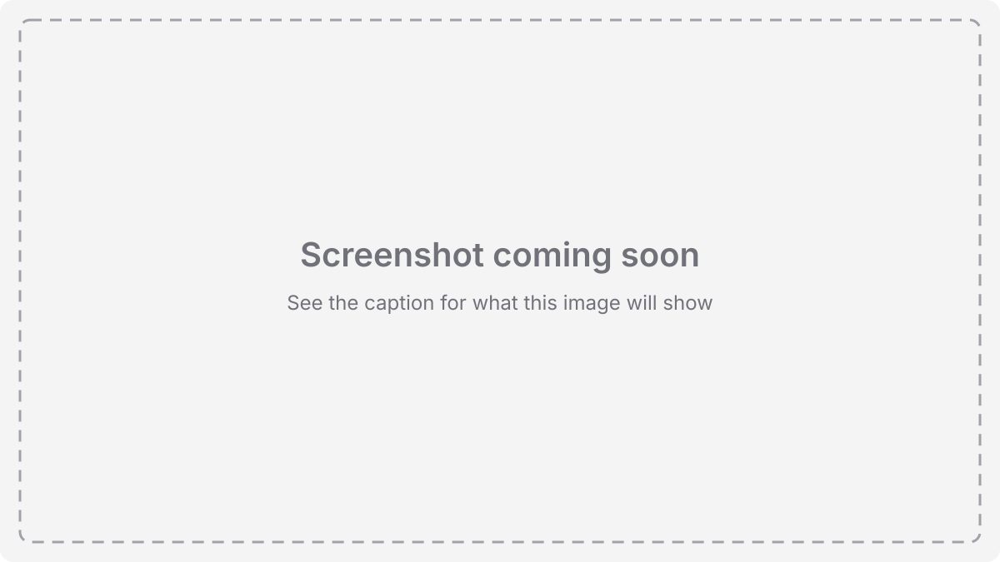

<Info>
  Availability: Feed is in early access. When it is turned on, selecting **Team** in the sidebar opens Feeds. If Team opens Agents instead, Feed is not turned on for your workspace yet. Contact your workspace admin or Oculon support to request access.
</Info>

Feed is where your [custom agents](/concepts/ai-and-agents/custom-agents) post the work they finish. Each item is a card that summarizes what an agent did, shows the result, and tells you whether you need to act.

Use Feed to keep up with agent output without opening every run.

{/* ASSET TODO: Feed list with several agent cards, the agent filter, and a "Needs you" card. Replace placeholder with /images/ai-and-agents/feed-list.png */}
<Frame>
  
</Frame>

## What a feed card contains

A card starts with a title and a short summary of what the agent did. It can also show key metrics, charts, or tables.

If the agent produced files or artifacts, the card lists them with an output status such as ready, pending, or failed. It can link to the resource the agent worked on, such as a board, and show external actions, such as a message the agent wants to post to Slack.

## Cards that need you

Some cards need a person before the agent can continue. These cards are marked Needs you or Pending approval.

Open the card and review the result and any proposed action. Select **Approve** or reject the action, and add a note to explain your decision if you want. When nothing is waiting on you, the card shows Nothing needed.

Who can approve depends on the routine's settings. See [Access and approvals](/concepts/ai-and-agents/custom-agents/agent-permissions). To hear about these cards right away, set up your [notifications](/concepts/settings-and-administration/personal-settings/notifications).

{/* ASSET TODO: Feed card detail with a pending approval, the decision note field, and the collaboration panel. Replace placeholder with /images/ai-and-agents/feed-card-detail.png */}
<Frame>
  
</Frame>

## Filter and sort

Use **Filter by agent** to see updates from one agent, or choose All agents. Sort by Newest first or Oldest first, and select **Load earlier updates** to see older cards.

## Collaborate on a card

Each card has a collaboration area. You can comment on the result and mention a teammate, or turn the card into a task in a project. Activity shows who has acted on the card.

## Resolve a card

When you are done with a card, select **Mark resolved**. Resolved cards move out of your main feed. Select **Reopen** on a resolved card if you need to revisit it.

## Who can see a card

You see feed cards for agents that are shared with you. If an agent is not shared with anyone else, only you see its cards. To change who can see an agent, update its sharing in [Access and approvals](/concepts/ai-and-agents/custom-agents/agent-permissions).
