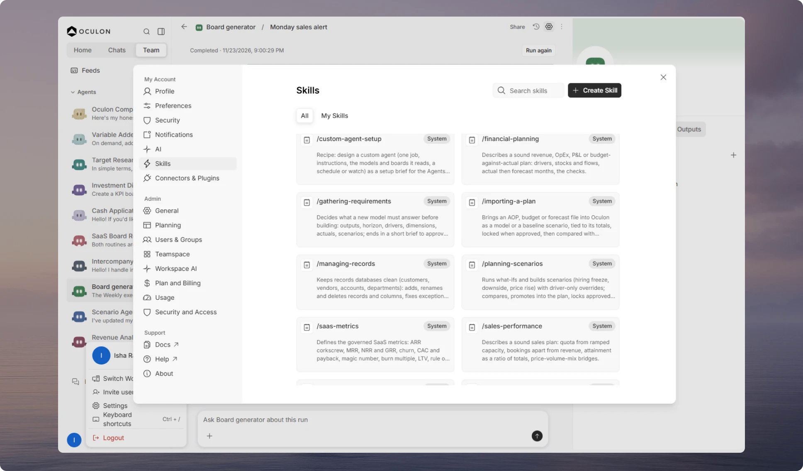
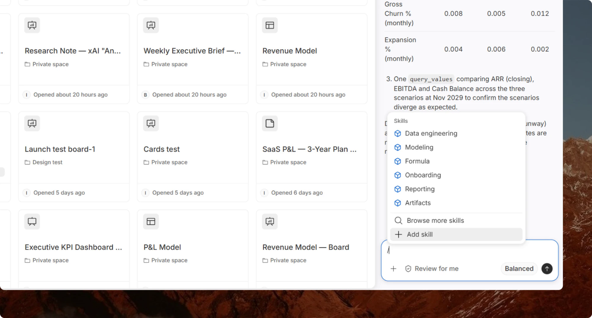

A skill is a saved set of instructions that the [AI assistant](/concepts/ai-and-agents/ai-assistant) follows for one kind of task. Use skills when you ask for the same type of work often, such as a variance summary or an anomaly check.

Skills give you consistent output without retyping the same rules in every chat.

## Find your skills

Open **My Account → Skills**. The All tab shows every skill available to you in the workspace, and the My Skills tab shows the skills you created. Use Search skills to find a skill by name.

<Frame>
  
</Frame>

Skills tagged System come with Oculon. You can use them, but only skills you created can be edited or deleted.

## Create a skill

1. Open **My Account → Skills** and click **Create Skill**.
2. Enter a Skill name, such as `/metric-anomaly-detection`.
3. Enter a Skill description that explains when to use it, such as `Detect unexpected metric changes, forecasting risks, and data anomalies.`
4. Enter the Skill instructions the assistant should follow, then save the skill.

## Use a skill in chat

Open the AI assistant and type `/` in the chat composer. The menu lists your Skills and any Plugins connected to the workspace. Select the skill, add any details for this request, and send the message.

From the same menu, select **Browse more skills** to see every skill available to you, or **Add skill** to create one.

<Frame>
  
</Frame>

## Write a good skill

Cover one task per skill. A focused skill is easier to trust than one that tries to do everything.

Describe the output you expect, such as a table, three bullet points, or a short narrative. Name the metrics, scenarios, or time ranges the skill should use by default.

Write the description so a teammate knows when to pick this skill.

## Delete a skill

Open the skill under My Skills and select **Delete Custom Skill**. You can only delete skills you created.
