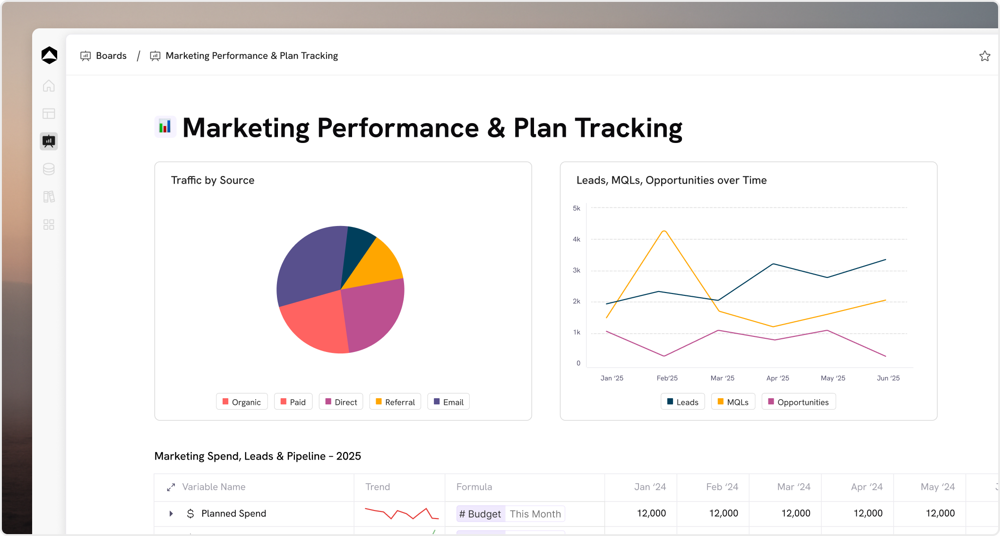

A board is a visual reporting surface in Oculon. It combines charts, tables, KPI blocks, embeds, and other summary elements so you can present model and data outputs clearly.

Create boards from the Library with **Create Board**, or open existing boards from the Library **Boards** tab.

<Frame caption="Boards in Oculon">
  
</Frame>

## In this section

<Columns cols={2}>
  <Card title="What is a board" icon="circle-question-mark" href="/concepts/analysis-and-reporting/boards/what-is-a-board">
    When to use boards and how to create one.
  </Card>
  <Card title="Board layout" icon="layout-grid" href="/concepts/analysis-and-reporting/boards/board-layout">
    Structure the canvas so readers can scan quickly.
  </Card>
  <Card title="Charts" icon="chart-line" href="/concepts/analysis-and-reporting/boards/charts">
    Add and configure chart cards.
  </Card>
  <Card title="Chart types catalog" icon="list" href="/concepts/analysis-and-reporting/boards/chart-types-catalog">
    Full Setup-tab chart type list.
  </Card>
  <Card title="Chart interaction" icon="mouse-pointer" href="/concepts/analysis-and-reporting/boards/chart-interaction">
    Filters, compare, and exploration controls.
  </Card>
  <Card title="Tables on boards" icon="table" href="/concepts/analysis-and-reporting/boards/tables-on-boards">
    Present detailed values beside visuals.
  </Card>
  <Card title="KPI and summary blocks" icon="gauge" href="/concepts/analysis-and-reporting/boards/kpi-and-summary-blocks">
    Highlight headline metrics with Metric Block.
  </Card>
  <Card title="Pivot tables" icon="table-2" href="/concepts/analysis-and-reporting/boards/pivot-tables">
    Insert Pivot Table cards from the slash menu.
  </Card>
  <Card title="Model block" icon="box" href="/concepts/analysis-and-reporting/boards/model-block">
    Embed a model on a board.
  </Card>
  <Card title="Dimension block" icon="columns-3" href="/concepts/analysis-and-reporting/boards/dimension-block">
    Embed a dimension on a board.
  </Card>
  <Card title="Transactions block" icon="table" href="/concepts/analysis-and-reporting/boards/transactions-block">
    Embed Transactions on a board.
  </Card>
  <Card title="Code block on boards" icon="code" href="/concepts/analysis-and-reporting/boards/code-block-on-boards">
    AI-assisted code blocks when available.
  </Card>
  <Card title="Sharing boards" icon="share-2" href="/concepts/analysis-and-reporting/boards/sharing-boards">
    Share decision-ready boards with the right access.
  </Card>
  <Card title="Board best practices" icon="badge-check" href="/concepts/analysis-and-reporting/boards/board-best-practices">
    Keep boards clear and maintainable.
  </Card>
</Columns>
