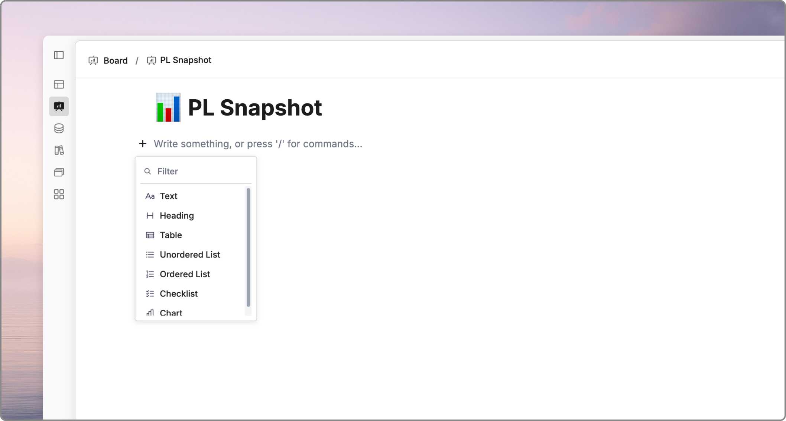

Board layout controls how quickly someone can understand the message on the page.

## Adding content to the canvas

<Frame caption="Insert content on a board">
  
</Frame>

The board canvas combines data visualizations with descriptive text.

Open the insert / slash menu to add items such as:

| Item | Description |
| :--- | :--- |
| **Text** | Formatted text or headings for context |
| **Bulleted / Numbered List** | Lists for key points or steps |
| **Checklist** | Interactive checkboxes |
| **Table** | Manual table for structured notes or values |
| **Pivot Table** | Pivot-style analysis card |
| **Chart** | Visualization powered by model data |
| **Metric Block** | Headline KPI summary card |
| **Model** | Embedded model |
| **Transactions** | Embedded Transactions |
| **Dimension** | Embedded dimension |
| **Code block (AI)** | Available only when artifacts/code features are enabled |

You can also type text directly on the canvas without opening the menu.

## Layout and arrangement

- Arrange cards side by side when related metrics belong together.
- Hover a block to reveal its handle, then drag to move it.
- Use the handle menu to copy, duplicate, or delete a block.
- Shift cards between full-width and half-width by placing them side by side.

## Start with information hierarchy

Put headline KPIs and the core question at the top. Follow with supporting charts and detail tables. Keep secondary analysis lower on the page.

## Group related content

A board should read in sections, not as a wall of visuals. Keep related metrics, filters, and explanations together so the viewer does not have to reconstruct the story.

## Design for scanning

Use enough spacing, clear labels, and a consistent reading order. If a board only makes sense after a long explanation, the layout needs more structure.

## Related pages

- [Charts](/concepts/analysis-and-reporting/boards/charts)
- [KPI and summary blocks](/concepts/analysis-and-reporting/boards/kpi-and-summary-blocks)
- [Board best practices](/concepts/analysis-and-reporting/boards/board-best-practices)
