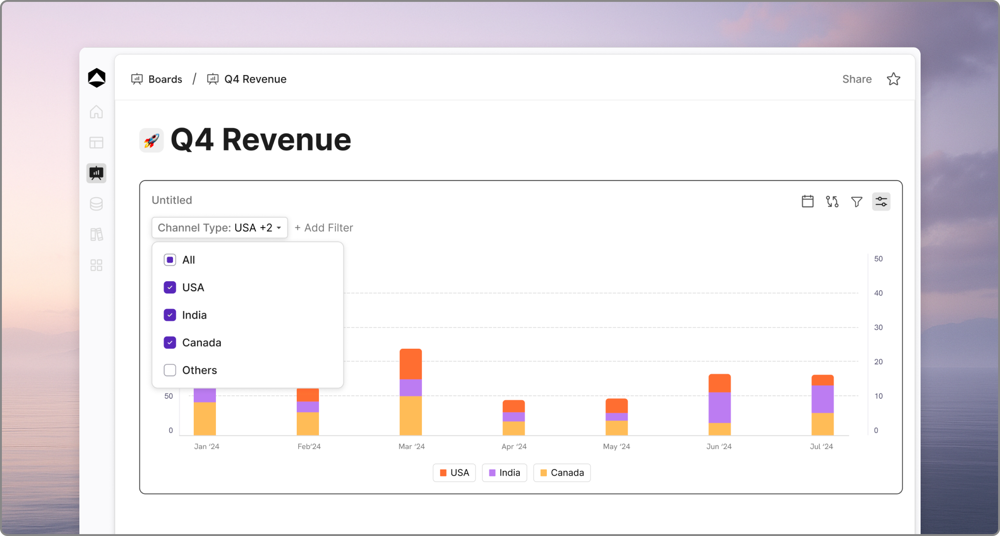

<Frame caption="Chart interactions">
  
</Frame>

A board is most useful when the viewer can explore the data without losing the main story. Chart cards support on-the-fly filters and deeper inspection.

## Renaming and top panel actions

- **Rename** — Click the chart title to edit it.
- **Date** — Add time-based filters or adjust rollup.
- **Compare** — Turn on side-by-side comparisons across time ranges or scenarios. See [Compare](/concepts/analysis-and-reporting/compare/what-is-a-compare).
- **Filter** — Add a Dimension or Scenario filter.
- **Config** — Open the right-side configuration panel.

## Active filter management

When dimensions or scenarios are filtered, they appear as interactive tags on the card.

- Click a filter tag to adjust selected values.
- Use **+ Add Filter** to layer additional dimensions or scenarios.

## Data exploration tools

- **Hover tooltips** — Inspect precise time and value details.
- **Legends and labels** — Match series to variables or dimension slices.

## Keep interactions predictable

Interactive controls should change the board in ways the viewer expects. If one filter changes only part of the page while another changes everything, label that difference clearly.

## Design for both readers and explorers

Some people only want the headline. Others want to investigate. A good board works for both.

## Related pages

- [Charts](/concepts/analysis-and-reporting/boards/charts)
- [Time compare](/concepts/analysis-and-reporting/compare/time-compare)
- [Scenario compare](/concepts/analysis-and-reporting/compare/scenario-compare)
