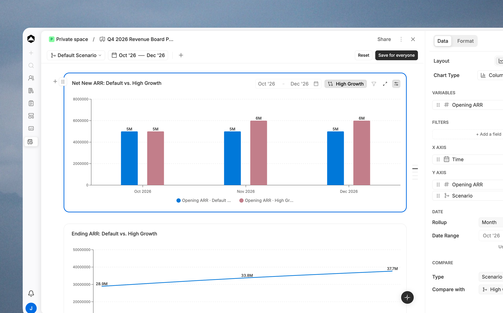
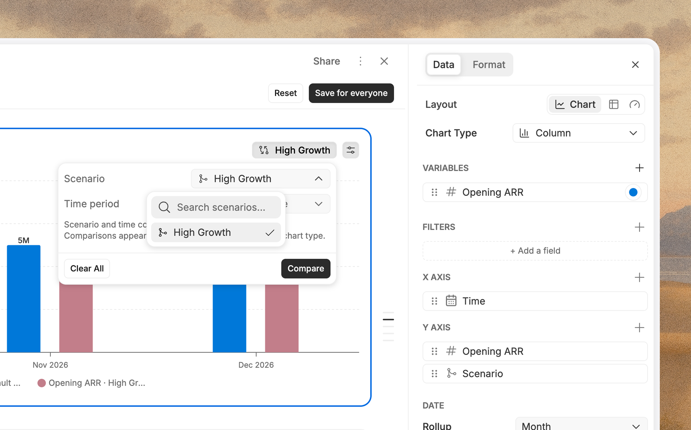
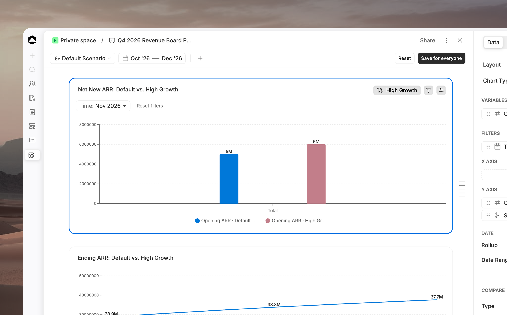
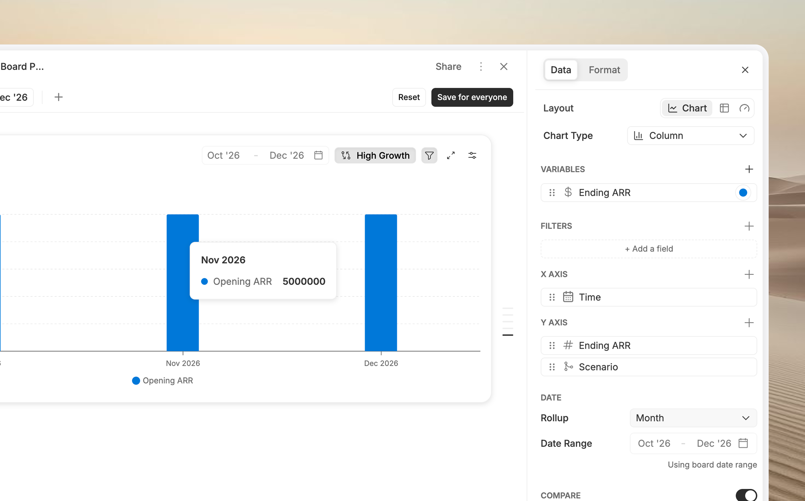

A board is most useful when the viewer can explore the data without losing the main story. Chart cards support on-card controls and a right-side **Data** / **Format** panel.

<Frame caption="Chart card with scenario and date controls">
  
</Frame>

## Card header actions

- **Rename** — Click the chart title to edit it.
- **Scenario** — Change the scenario used on the card when Scenario is in **Filters**.
- **Date range** — Adjust the card date range from the calendar control on the card.
- **Filter** — Open dimension or scenario filters placed on the card.
- **Config** — Open the right-side panel (**Data** and **Format**).

Board-level scenario and date range controls above the cards can apply to the whole board. A card can use the board date range or set its own under **Data** → **Date**.

## Compare on a chart

Turn on **Compare** in the **Data** tab to stack scenarios or time periods on the card. See [Compare](/concepts/analysis-and-reporting/compare/what-is-a-compare), [Scenario compare](/concepts/analysis-and-reporting/compare/scenario-compare), and [Time compare](/concepts/analysis-and-reporting/compare/time-compare).

<Frame caption="Compare on a chart">
  
</Frame>

## Active filters

When dimensions or scenarios are on **Filters**, they appear as controls on the card.

- Click a filter control to adjust selected values.
- Add another field from **Data** → **Filters**.

<Frame caption="Active filters on a chart">
  
</Frame>

## Data exploration tools

- **Hover tooltips** — Inspect precise time and value details.
- **Legends and labels** — Match series to variables. Turn labels and values on under **Format**.

<Frame caption="Data exploration on a chart">
  
</Frame>

## Keep interactions predictable

Interactive controls should change the board in ways the viewer expects. If one filter changes only part of the page while another changes everything, label that difference clearly.

## Design for both readers and explorers

Some people only want the headline. Others want to investigate. A good board works for both.

## Related pages

- [Charts](/concepts/analysis-and-reporting/boards/charts)
- [Scenario compare](/concepts/analysis-and-reporting/compare/scenario-compare)
- [Time compare](/concepts/analysis-and-reporting/compare/time-compare)
