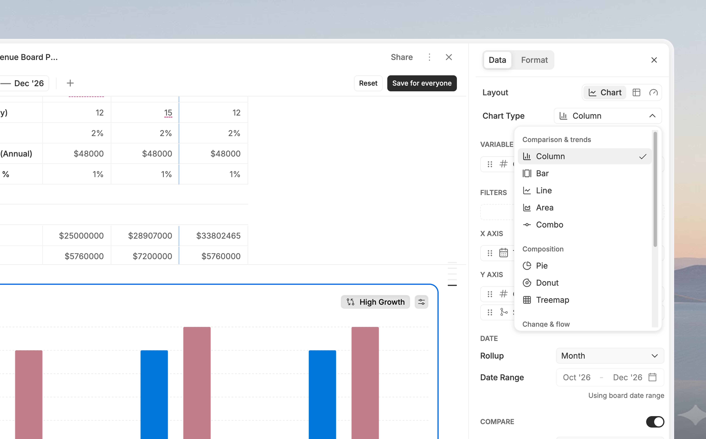

Choose the type in the chart **Data** tab under **Chart Type**. Types are grouped in the dropdown the same way they appear in the product.

<Frame caption="Chart Type dropdown">
  
</Frame>

## Comparison and trends

| Chart Type label | Typical use |
| :--- | :--- |
| **Column** | Compare discrete categories or periods as vertical columns |
| **Bar** | Compare categories as horizontal bars |
| **Line** | Show trends over continuous time |
| **Area** | Emphasize magnitude of change over time |
| **Combo** | Combine series styles when one chart needs mixed encodings |

## Composition

| Chart Type label | Typical use |
| :--- | :--- |
| **Pie** | Show composition of a whole |
| **Donut** | Composition with a compact center |
| **Treemap** | Nested hierarchical composition |

## Change and flow

| Chart Type label | Typical use |
| :--- | :--- |
| **Waterfall** | Bridge from a starting value to an ending value |
| **Funnel** | Stage conversion or drop-off |
| **Sankey** | Flow between categories or stages |

## Relationships

| Chart Type label | Typical use |
| :--- | :--- |
| **Scatter** | Relationship between two measures |
| **Bubble** | Relationship with an additional size encoding |
| **Heatmap** | Intensity across two categorical axes |

## Related layouts on the same card

On **Data** → **Layout**, the same card can switch to:

- **Pivot** — a pivot-style table. See [Pivot tables](/concepts/analysis-and-reporting/boards/pivot-tables).
- **Metric** — a KPI tile. See [KPI and summary blocks](/concepts/analysis-and-reporting/boards/kpi-and-summary-blocks).

You can also insert those as their own cards from the board insert menu.

## Choose the simplest readable type

Prefer the simplest chart that answers the question. If the audience needs exact values, pair the chart with a table or Metric card instead of overloading the visual.

## Related pages

- [Charts](/concepts/analysis-and-reporting/boards/charts)
- [Chart interaction](/concepts/analysis-and-reporting/boards/chart-interaction)
- [KPI and summary blocks](/concepts/analysis-and-reporting/boards/kpi-and-summary-blocks)
