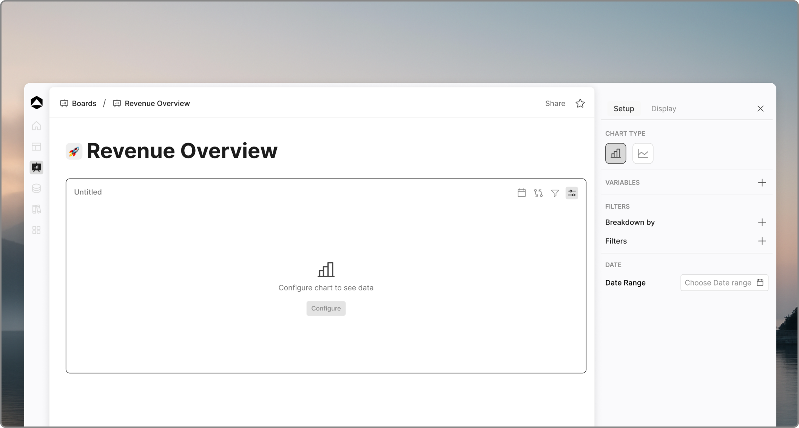
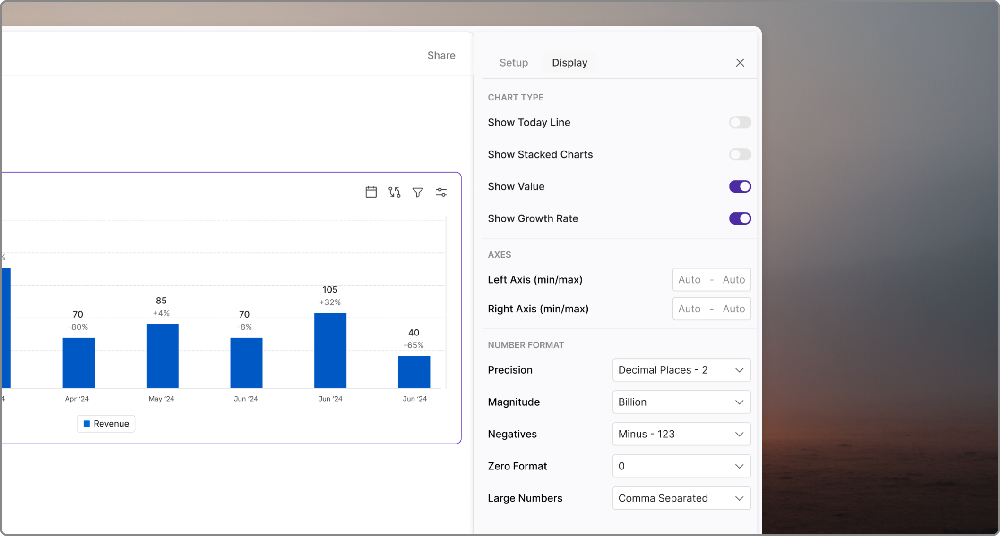

Charts help people see patterns faster than a raw grid can. Add a chart from the board insert / slash menu by choosing **Chart**.

For the full Setup-tab type list, see [Chart types catalog](/concepts/analysis-and-reporting/boards/chart-types-catalog).

## Adding a chart

<Frame caption="Chart configuration">
  
</Frame>

1. Insert a **Chart** card on the canvas.
2. A chart card is placed on the board and the configuration panel opens.
3. Use **Setup** to choose chart type, variables, breakdowns, and filters.
4. Use **Display** to refine axes, labels, and number formatting.

## Configuration: Setup tab

- **Chart type and theme** — Choose a visualization type from the catalog and a color theme.
- **Variables** — Select one or more variables from your models.
- **Breakdowns (dimensions)** — Split bars or lines into categorical slices.
- **Filters (dimensions and scenarios)** — Add controls on the card so viewers can change the slice.
- **Time filter** — Add a date range control on the card when needed.

## Configuration: Display tab

<Frame caption="Chart display settings">
  
</Frame>

Common display controls include:

| Setting | Description |
| :--- | :--- |
| **Show Today Line** | Vertical line for the current date on time-based charts |
| **Show Stacked Charts** | Stack dimension breakdowns per period |
| **Show Value** | Numeric labels on chart elements |
| **Show Growth Rate** | Period-over-period growth indicators |

Axes and number formatting controls let you set limits, precision, magnitude, negatives, and zero display.

## When to use a chart

Use a chart when the decision depends on movement, comparison, or composition. Common examples include growth trends, scenario deltas, and category mix. Avoid styling choices that make small changes look larger than they are.

## Related pages

- [Chart types catalog](/concepts/analysis-and-reporting/boards/chart-types-catalog)
- [Chart interaction](/concepts/analysis-and-reporting/boards/chart-interaction)
- [Time compare](/concepts/analysis-and-reporting/compare/time-compare)
- [Scenario compare](/concepts/analysis-and-reporting/compare/scenario-compare)
