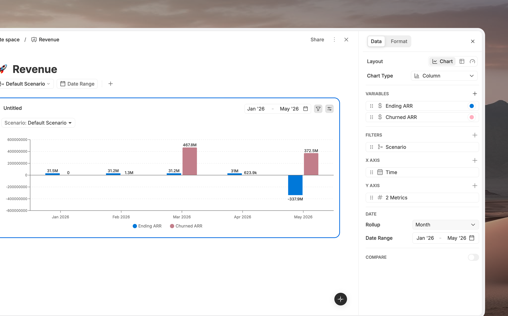
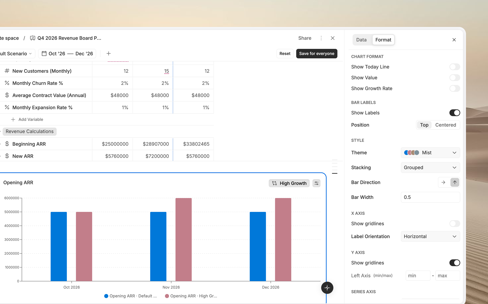
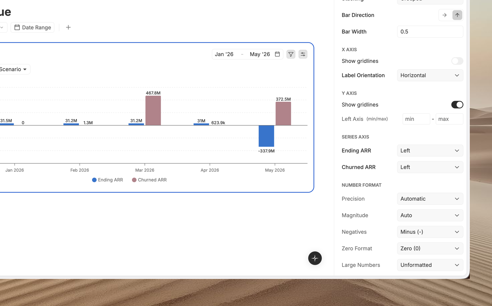

Charts help people see patterns faster than a raw grid can. Add a chart from the board insert / slash menu by choosing **Chart**.

The configuration panel opens on the right with two tabs: **Data** and **Format**. For the full chart type list, see [Chart types catalog](/concepts/analysis-and-reporting/boards/chart-types-catalog).

## Adding a chart

1. Insert a **Chart** card on the canvas.
2. The card is placed on the board and the configuration panel opens.
3. Use **Data** to choose the layout, chart type, variables, axes, date range, and compare.
4. Use **Format** to refine labels, theme, stacking, axes, and number formatting.

## Configuration: Data tab

<Frame caption="Chart Data tab">
  
</Frame>

**Data** decides what the card shows and how the numbers are sliced. Theme and label styling live on **Format**.

### Layout

Switch the same card between **Chart**, **Pivot**, and **Metric** without recreating it. The underlying variables and filters stay attached, so you can try a visual, a pivot table, or a KPI tile for the same question.

Use **Chart** for trends and comparisons, **Pivot** when people need exact cross-tabs, and **Metric** when the board only needs a headline number. See [Pivot tables](/concepts/analysis-and-reporting/boards/pivot-tables) and [KPI and summary blocks](/concepts/analysis-and-reporting/boards/kpi-and-summary-blocks).

### Chart Type

Choose the visualization under **Chart Type** (for example **Column**, **Bar**, or **Line**). The dropdown groups types the same way the product does: comparison and trends, composition, change and flow, and relationships.

Pick the simplest type that answers the question. Change type when the story changes (for example from trend over time to share of total), not only for decoration. Full list: [Chart types catalog](/concepts/analysis-and-reporting/boards/chart-types-catalog).

### Variables

Add the model variables you want to plot, such as `Ending ARR` and `Churned ARR`. Each variable becomes a series (or a metric on a KPI / pivot layout).

Start with the few variables that drive the decision. Extra series make the chart harder to read and slower to explain in a review.

### Filters

Drop dimensions or **Scenario** onto **Filters** so the card can narrow what it shows. Filtered fields appear as controls on the card, so viewers can change the slice without opening **Data**.

Use filters when the board should stay interactive (region, product, scenario) without building a separate card for every cut. Keep the default filter values aligned with the story you want people to see first.

### X Axis and Y Axis

Map **Time**, dimensions, or metrics onto each axis. On a vertical **Column** chart, time usually sits on **X Axis** and metrics on **Y Axis**. On horizontal **Bar**, those axis labels swap so categories stay readable.

Put the continuous scale (time or the measure) where people expect it, and keep category breakdowns on the other axis. If the chart looks sideways or crowded, check that time and metrics are on the intended axes before you change type.

### Date

Set **Rollup** to **Month**, **Quarter**, or **Year**, and choose the card **Date Range**. You can follow the board date range or override it for this card only.

Use rollup to match the planning cadence of the discussion (monthly ops vs quarterly board packs). A focused date range keeps the chart about the period under review instead of the whole model history.

### Compare

Turn **Compare** on to stack another **Scenario** or a **Time** period against the card’s current baseline. Selecting scenario compare clears time compare, and the other way around. Changes apply as soon as you pick a target.

Use compare when the decision is a variance (forecast vs budget, this year vs last year), not when you only need one series. For the full compare workflow, see [Compare](/concepts/analysis-and-reporting/compare/what-is-a-compare).

## Configuration: Format tab

<Frame caption="Chart Format tab">
  
</Frame>

**Format** controls how the plotted data is drawn. On column, bar, line, area, and combo charts, the sections below are available. Pie, donut, funnel, and other types show a shorter set that matches what that chart can draw.

### Show Today Line

Draws a vertical line at the current date on time-based charts. It is hidden for horizontal **Bar**, where a today line would not map cleanly across categories.

Turn it on when the audience needs to see where actuals end and the plan continues, especially next to a [Last actual date](/concepts/data-and-structure/time/last-actual-date) in the model.

### Show Value

Shows numeric values on chart elements (bars, points, or slices). Pair it with **Bar labels** when you want every bar annotated.

Use values when the meeting needs exact magnitudes without hovering. Turn them off on dense charts where labels collide.

### Show Growth Rate

Adds period-over-period growth indicators on time-based charts. Like **Show Today Line**, it only appears when the chart has a time category axis.

Use it for MoM or similar growth reviews. Prefer a dedicated compare or a second series when you need a fuller variance story.

### Show Labels and Position

**Show Labels** turns bar (or bar-and-line) labels on or off. **Position** places them at **Top** or **Centered** on the bar. Combo charts call this section **Bar and line labels**.

Keep labels on for a small number of series. Use **Top** for grouped columns and **Centered** when bars are tall enough that a mid-bar label stays readable.

### Theme

Sets the color palette for the series: **Mist**, **Clay**, **Vivid**, **Pop**, **Ember**, **Citrus**, **Cascade**, **Orchid**, or **Marina**.

Pick one theme per board so related cards feel consistent. Change theme when you need stronger contrast for projection or print, not for every card individually.

### Stacking

Choose **Grouped**, **Stacked**, or **100%**. Grouped keeps series side by side. Stacked adds them into a total. **100%** normalizes each period to a share of the whole.

Use **Grouped** for direct series comparison, **Stacked** for composition of a total, and **100%** when the mix matters more than the absolute size.

### Bar Direction and Bar Width

**Bar Direction** switches between **Vertical** (columns) and **Horizontal** (bars). **Bar Width** sets relative thickness (for example `0.5`).

Use horizontal bars when category names are long. Narrow the width when many periods share the axis so gaps stay visible.

### X Axis and Y Axis (Format)

**Show gridlines** toggles grid lines on each axis. **Label Orientation** on the X axis can be **Horizontal**, **Angled**, or **Vertical**. **Left Axis** (and **Right Axis** when used) accept optional min and max bounds.

Turn gridlines on when people need to read values against a scale. Set min/max when auto-scaling exaggerates small moves or hides the zero baseline you want in the story.

### Series Axis

For each variable, choose **Left** or **Right** axis. Series axis is available when the chart is not stacked and more than one metric is plotted.

Put a secondary scale on the right when two metrics have very different magnitudes (for example dollars vs a rate). Avoid dual axes when a single scale still tells the truth clearly.

### Number format

<Frame caption="Series axis and number format">
  
</Frame>

| Setting | How it works | Why use it |
| :--- | :--- | :--- |
| **Precision** | **Automatic**, or lock **Decimal Places** / **Significant Figures** (0–10) | Match the precision finance partners expect in the room |
| **Magnitude** | **Auto**, or force **Thousand**, **Million**, **Billion**, **Trillion**, **Lakh**, or **Crore** | Keep axis labels and values in one unit across the board |
| **Negatives** | **Minus (-)** or **Bracket [ ]** | Match local reporting style for losses and churn |
| **Zero Format** | **Zero (0)** or **Dash (-)** | Prefer dashes when zero means “no activity” rather than a measured zero |
| **Large Numbers** | **Unformatted**, **Compact**, or **Comma Separated** | Compact helps dense charts; commas help when people read exact figures |

## When to use a chart

Use a chart when the decision depends on movement, comparison, or composition. Common examples include growth trends, scenario deltas, and category mix. Avoid styling choices that make small changes look larger than they are.

## Related pages

- [Chart types catalog](/concepts/analysis-and-reporting/boards/chart-types-catalog)
- [Chart interaction](/concepts/analysis-and-reporting/boards/chart-interaction)
- [Scenario compare](/concepts/analysis-and-reporting/compare/scenario-compare)
- [Time compare](/concepts/analysis-and-reporting/compare/time-compare)
