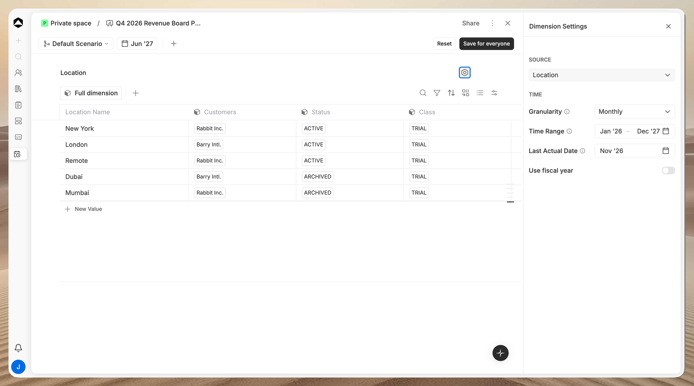

Use **Dimension** from the board slash / insert menu to embed a dimension on the board.

The insert flow opens a picker so you choose the dimension before the block is added.

<Frame caption="Dimension block on a board">
  
</Frame>

## Dimension Settings

Open **Dimension Settings** on the block to choose the source dimension and its time settings. Views for the dimension stay on the block’s view bar.

### Source

**Choose source** (or the source picker) selects which dimension the block embeds. Switching asks for confirmation and lands on the new dimension’s default view.

Use a different source when the board should show another category structure without inserting a new block.

### Time

| Setting | What it does |
| :--- | :--- |
| **Granularity** | Sets the time interval formula-derived variables on the dimension use (**Monthly**, **Quarterly**, **Yearly**, and related options). |
| **Time Range** | Sets the date span those formula variables cover for this dimension. |
| **Last Actual Date** | Applies actual formulas through this date and plan formulas after it. |
| **Use fiscal year** | Aligns dimension time with fiscal-year settings when your workspace plans that way. |

Match granularity and range to how the board talks about categories over time. Keep **Last Actual Date** consistent with related models so actual vs plan does not disagree across blocks. See [Last actual date](/concepts/data-and-structure/time/last-actual-date) and [Time](/concepts/data-and-structure/time).

## When a Dimension block helps

- The board depends on category structure that lives in a dimension
- Readers need to inspect dimension members in context of the report
- The embedded dimension should stay aligned with Library dimension updates

## Prefer charts when the story is the metric

If the audience only needs a breakdown of a metric, a chart with dimension breakdowns may be clearer than embedding the dimension itself.

## Related pages

- [What is a dimension](/concepts/data-and-structure/dimensions/what-is-a-dimension)
- [Board layout](/concepts/analysis-and-reporting/boards/board-layout)
- [Charts](/concepts/analysis-and-reporting/boards/charts)
