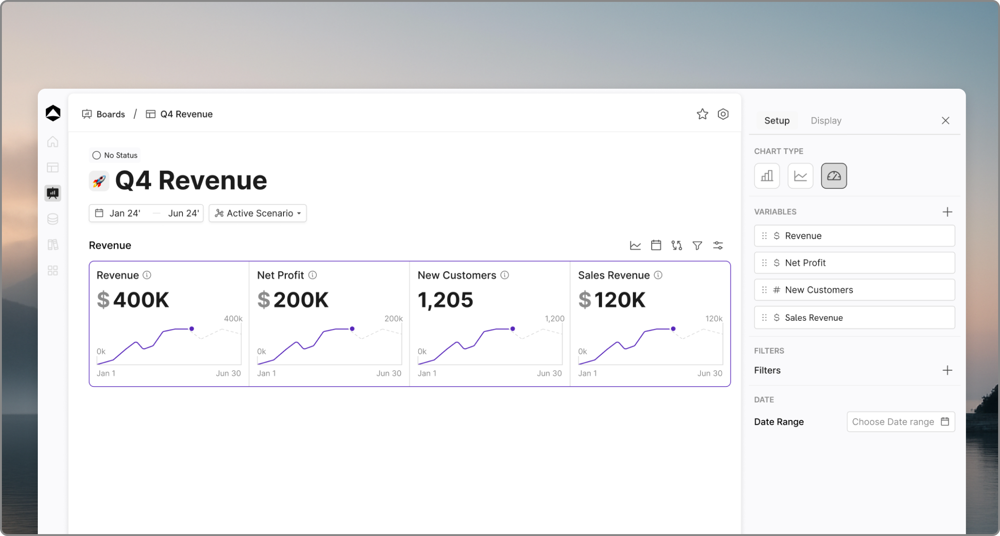

KPI and summary blocks answer the top-level question quickly. In the board insert menu, add a **Metric Block**.

<Frame caption="Metric Block on a board">
  
</Frame>

## Metric Block

While charts excel at comparisons and trends, **Metric Block** is designed for high-impact KPI reporting.

### Capacity and setup

- A Metric Block can group related headline metrics in one card.
- Setup follows the same variable, filter, and scenario patterns used by chart cards.

### Sparklines

Toggle sparklines when you want a compact trend beside the headline value without adding a full chart.

## Filtering and operations

Metric Blocks support the same operational patterns as charts:

- Scenario comparison
- Dimension and time filters on the card
- Consistent filter behavior with other chart cards

## Use summaries to frame the page

Place the most decision-relevant metrics near the top of the board. These summary blocks should prepare the viewer for the rest of the page, not repeat it.

## Avoid KPI overload

Too many summary blocks compete for attention. If every number is treated as headline content, none of them are.

## Related pages

- [Charts](/concepts/analysis-and-reporting/boards/charts)
- [Chart types catalog](/concepts/analysis-and-reporting/boards/chart-types-catalog)
- [Board layout](/concepts/analysis-and-reporting/boards/board-layout)
