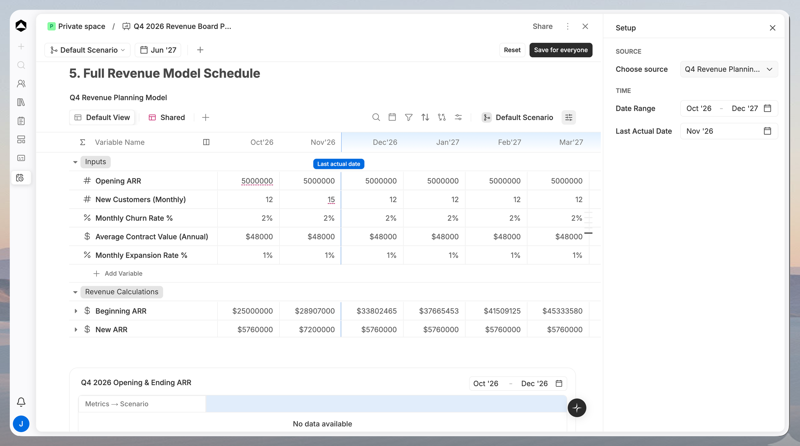

Use **Model** from the board slash / insert menu to embed a model on the board.

The insert flow opens a picker so you choose the model before the block is added.

<Frame caption="Model block on a board">
  
</Frame>

## Setup

Open **Setup** on the block to change the embedded model and its time context. Switching the source asks for confirmation because the grid rebuilds from the new model.

### Source

**Choose source** picks which model the block shows. Use it when the board should follow a different planning model without recreating the block.

Confirm before you switch. The new model replaces the grid; saved work on the previous model stays in that model.

### Time

| Setting | What it does |
| :--- | :--- |
| **Date Range** | Sets the start and end of the periods the embedded model grid shows. |
| **Last Actual Date** | Marks where actual formulas stop and planned formulas begin in the embedded model. |

Keep the date range aligned with the board’s review period so readers are not scanning unrelated months. Set **Last Actual Date** to match how the source model is closed, or the grid can mix actual and plan in the wrong periods. See [Last actual date](/concepts/data-and-structure/time/last-actual-date).

## When a Model block helps

- The board needs live model context, not only a chart of one metric
- Readers may need to inspect the underlying planning structure from the board
- The embedded model should stay aligned with the source as it changes

## Keep embeds intentional

Prefer focused charts, Metric Blocks, or Pivot Tables when the audience only needs a summary. Embed a full model when the model itself is part of the review.

## Related pages

- [What is a model](/concepts/modeling/models/what-is-a-model)
- [Board layout](/concepts/analysis-and-reporting/boards/board-layout)
- [Tables on boards](/concepts/analysis-and-reporting/boards/tables-on-boards)
