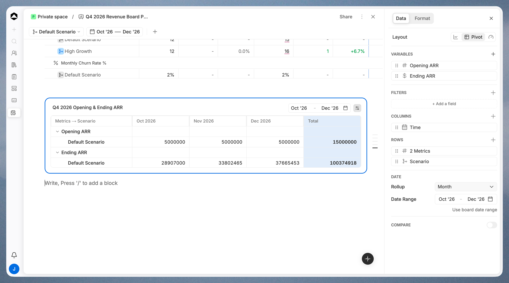

Use **Pivot Table** from the board slash / insert menu when you need a model-powered table layout on the board.

A Pivot Table is the same board card pattern as a chart, opened in a **Pivot** layout. You pick variables once, then arrange **Metrics**, **Time**, **Scenario**, and dimensions across **Filters**, **Rows**, and **Columns** so the grid answers the question with exact values.

<Frame caption="Pivot Table on a board">
  
</Frame>

## How a pivot table works

A pivot table crosses categories so each cell is one combination of the fields you placed.

- Fields on **Rows** stack down the left side of the grid
- Fields on **Columns** spread across the top
- Fields on **Filters** sit above the card as selectors, so viewers can change the slice without editing the layout
- **Metrics** (model variables) supply the numbers in the cells

Nesting follows list order. Put `Scenario` under **Metrics** on **Rows** when each metric should break into scenarios. Put **Time** on **Columns** when periods should read left to right. Swap those placements when you want periods down the side and scenarios across the top.

## Configure the layout

Open the card’s **Data** tab. Set **Layout** to **Pivot** (you can switch the same card to **Chart** or **Metric** later without rebuilding it).

### Variables

Add the model variables the table should show, such as `Opening ARR` and `Ending ARR`. Those metrics appear in the layout shelves so you can place them on **Rows**, **Columns**, or **Filters**.

Start with the few metrics that support the review. Extra metrics widen the grid and make the story harder to scan.

### Filters, Rows, and Columns

The layout shelves are drag-and-drop:

| Shelf | What it does |
| :--- | :--- |
| **Filters** | Narrows the whole table. Each field becomes a control above the card. |
| **Rows** | Categories and nesting down the side of the grid. |
| **Columns** | Categories across the top of the grid. |

Drag **Metrics**, **Time**, **Scenario**, or a dimension between shelves, or reorder within a shelf. The grid updates as you move fields.

Typical board setups:

- **Time** on **Columns**, **Metrics** and **Scenario** on **Rows** — period-by-period values with scenario detail under each metric
- A dimension such as `Region` on **Rows** or **Columns** — break the same metrics by category
- **Scenario** or a dimension on **Filters** — keep one default slice visible, and let viewers change it from the card

**Time** and **Scenario** stay available as placeable fields. Move them where the story needs them; do not leave the table without a clear time or scenario context unless the board filters already provide it.

### Date

Set **Rollup** (**Month**, **Quarter**, or **Year**) and the card **Date Range**. You can follow the board date range or override it for this card only.

Match rollup to the planning cadence of the discussion. A focused range keeps the pivot about the period under review.

### Compare

Turn **Compare** on to stack another **Scenario** or **Time** period against the card’s baseline. Use it for variance-style pivots. For the full compare workflow, see [Compare](/concepts/analysis-and-reporting/compare/what-is-a-compare).

## When to use a Pivot Table

- You need exact values in a structured grid on the board
- The audience needs metrics crossed with time, scenario, or dimensions
- A basic insert **Table** is not enough because the data should stay connected to model variables
- A chart shows the shape, but the meeting still needs the numbers in cells

## Keep pivot cards focused

Show the measures, dimensions, and periods that support the board’s question. Do not recreate the entire model grid on the board.

Prefer one clear cross-tab per card. If you need both a trend and a detailed grid, use a [chart](/concepts/analysis-and-reporting/boards/charts) next to the pivot rather than overloading one layout.

## Related cards

- Basic **Table** for manual or lightweight tables: [Tables on boards](/concepts/analysis-and-reporting/boards/tables-on-boards)
- Charts for trends and composition: [Charts](/concepts/analysis-and-reporting/boards/charts)
- Metric Block for headline KPIs: [KPI and summary blocks](/concepts/analysis-and-reporting/boards/kpi-and-summary-blocks)

## Related pages

- [Board layout](/concepts/analysis-and-reporting/boards/board-layout)
- [Tables on boards](/concepts/analysis-and-reporting/boards/tables-on-boards)
- [Compare](/concepts/analysis-and-reporting/compare/what-is-a-compare)
