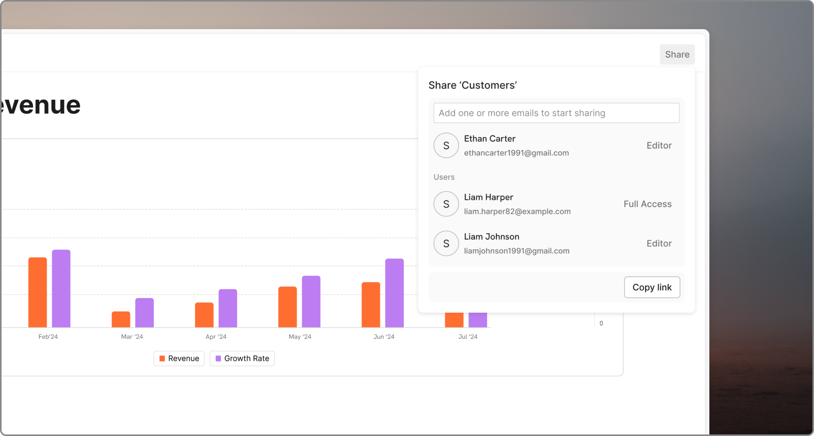

Boards are one of the most common ways to share Oculon content with non-builders.

Sharing boards works like sharing other Library resources. You can share boards with workspace members and grant access levels such as **View**, **Edit**, or **Full Access**.

<Frame caption="Share a board">
  
</Frame>

## Share with the right level of detail

The best shared board shows the decision-ready view, not the full model construction. Share enough to support action, but not so much that viewers have to decode the underlying logic themselves.

## Check permissions before sharing

If a board draws from restricted models or Transactions, confirm the audience can access what they need. A board that loads partially or hides key numbers creates confusion.

## Review the board as the audience will see it

Before you share, open the board with the same filters, scenario, and time range the audience will use. That catches mismatches early.

## Related pages

- [What is a board](/concepts/analysis-and-reporting/boards/what-is-a-board)
- [Board best practices](/concepts/analysis-and-reporting/boards/board-best-practices)
- [Sharing basics](/concepts/workspace-and-collaboration/sharing-and-permissions)
