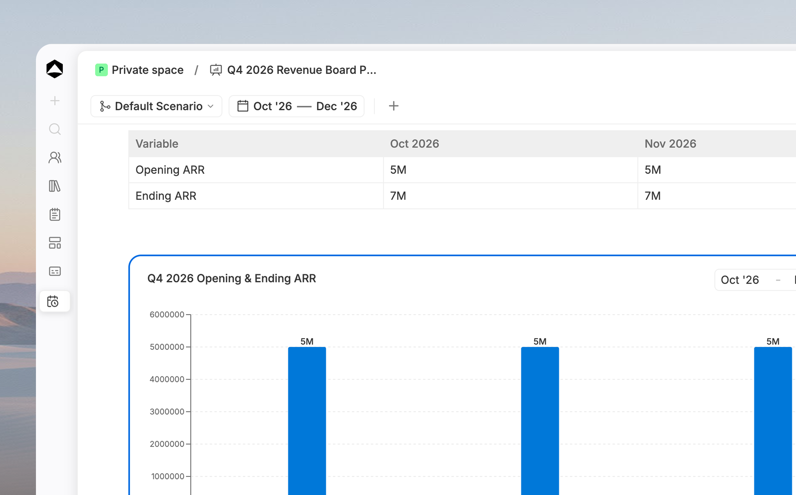

Tables are useful when the audience needs exact values, not only trends.

<Frame caption="Tables on a board">
  
</Frame>

Insert a basic **Table** from the board slash menu for structured notes or values. For model-powered pivot layouts, use [Pivot tables](/concepts/analysis-and-reporting/boards/pivot-tables). For live source embeds, use [Model block](/concepts/analysis-and-reporting/boards/model-block), [Dimension block](/concepts/analysis-and-reporting/boards/dimension-block), or [Transactions block](/concepts/analysis-and-reporting/boards/transactions-block).

## When a table adds value

Use a table on a board when people need row-level review, variance detail, or supporting context for a chart.

## Keep the table focused

Do not place the full model on a board as a generic table. Show the subset of fields, dimensions, and time periods that explain the decision.

## Choose between a board table and an embedded view

If the same filtered slice also needs to live outside the board, reuse a saved [view](/concepts/analysis-and-reporting/views/what-is-a-view) rather than rebuilding the definition in several places.

## Pair tables with summaries

A table is easier to read when the board also includes a KPI or chart that explains why the table is being shown.

## Related pages

- [Pivot tables](/concepts/analysis-and-reporting/boards/pivot-tables)
- [KPI and summary blocks](/concepts/analysis-and-reporting/boards/kpi-and-summary-blocks)
- [Board layout](/concepts/analysis-and-reporting/boards/board-layout)
