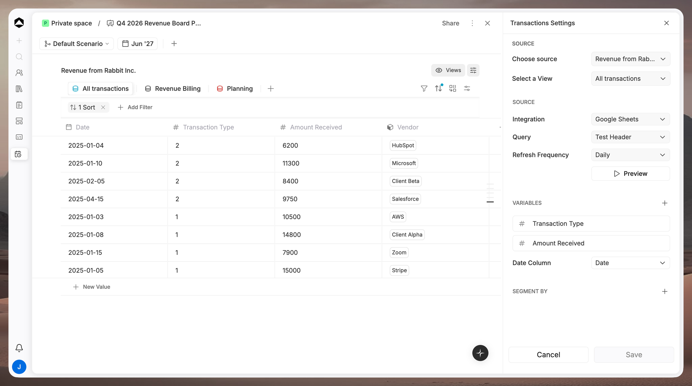

Use **Transactions** from the board slash / insert menu to embed a Transactions dataset on the board.

The insert flow opens a picker so you choose the Transactions source before the block is added.

<Frame caption="Transactions block on a board">
  
</Frame>

## Transactions Settings

Open **Transactions Settings** on the block to choose the embedded dataset, connection, and how columns map. The same settings surface the Library uses for Transactions, with board-specific source and view controls at the top.

### Source

| Setting | What it does |
| :--- | :--- |
| **Choose source** | Selects which Transactions dataset the block embeds. Switching asks for confirmation because the grid rebuilds. |
| **Select a View** | Picks which saved view of that dataset the block shows (filters, columns, and layout from that view). |

Use **Select a View** when the board should open on a specific slice (for example **All transactions** vs a billing view) instead of the default.

### Integration

| Setting | What it does |
| :--- | :--- |
| **Integration** | Chooses the connected system that feeds the dataset (for example Google Sheets). |
| **Query** | Selects the query or sheet range from that integration. |
| **Refresh Frequency** | Sets how often the connection refreshes (for example **Daily**). |
| **Preview** | Runs a preview of the current query so you can check rows before saving. |

Confirm integration and query when the board depends on live source data. Preview after changes so the embedded table does not surprise readers with empty or wrong columns.

### Variables

Map source fields into Transactions variables the grid can use. Set **Date Column** so time-aware filters and ordering know which field is the transaction date.

Keep variable names clear and typed correctly so charts and models that read the same Transactions stay consistent.

### Segment By

Add segment fields when the dataset should split by a category for analysis on the board. Leave it empty when the flat transaction list is enough.

## When a Transactions block helps

- The report needs live source records, not only modeled outputs
- Readers may need to inspect operational detail from the board
- The embedded dataset should stay aligned with Library Transactions updates

## Keep source and model roles clear

Use Transactions embeds for source detail. Use charts, Metric Blocks, and model embeds for planning logic and decision summaries. See [Transactions](/concepts/data-and-structure/transactions).

## Related pages

- [What is a transaction](/concepts/data-and-structure/transactions/what-is-a-transaction)
- [Board layout](/concepts/analysis-and-reporting/boards/board-layout)
- [Tables on boards](/concepts/analysis-and-reporting/boards/tables-on-boards)
