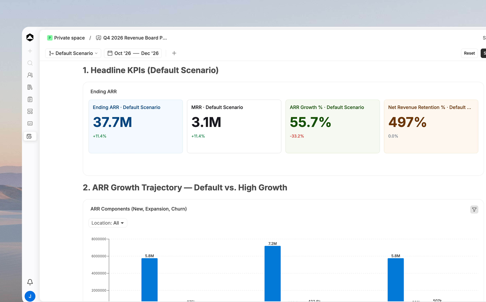
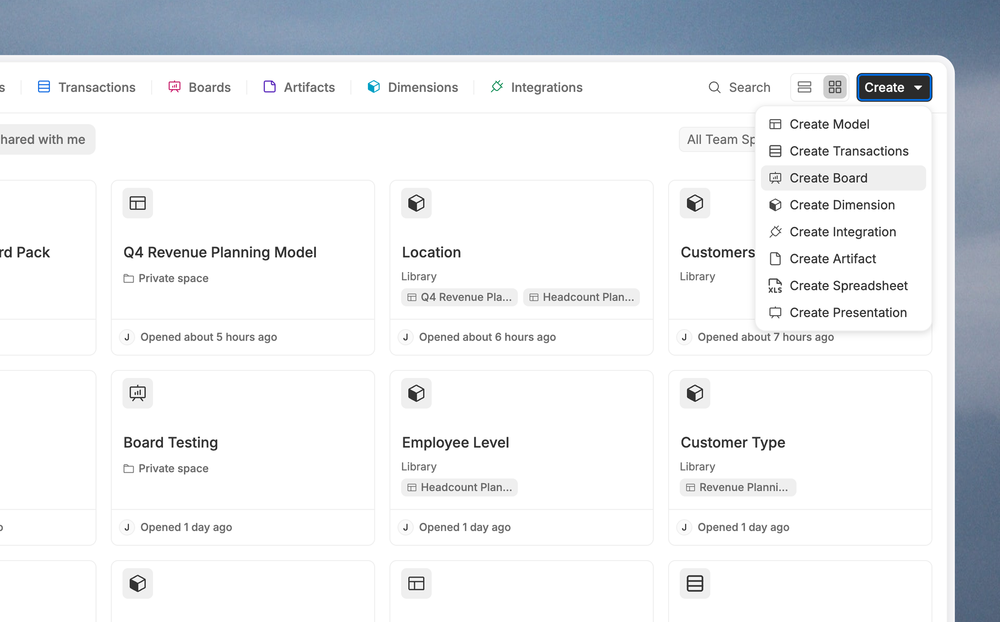
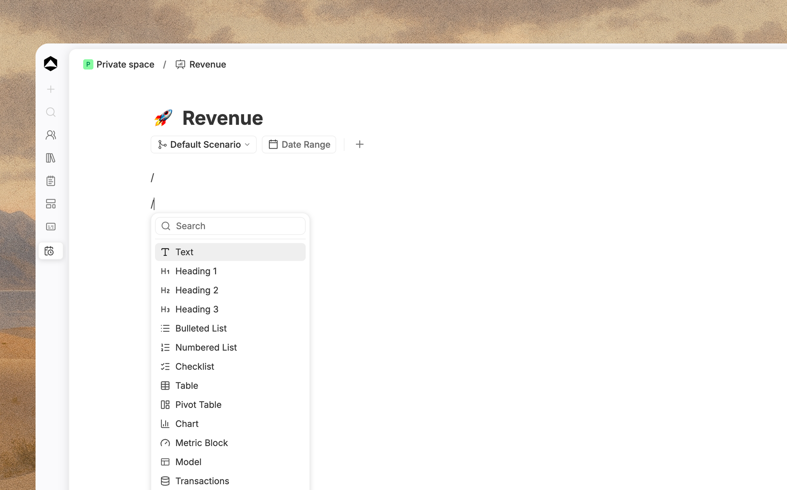

A board is a visual reporting surface in Oculon. It combines charts, tables, KPI blocks, and other summary elements so you can present model outputs clearly.

<Frame caption="A board in Oculon">
  
</Frame>

## Create a board

Boards are a primary way to share insights across your team.

### 1. Open Boards in the Library

Go to the Library **Boards** tab to see boards you can access.

### 2. Create a new board

From the Library, use **Create Board**. This creates a fresh reporting surface and opens it for editing.

<Frame caption="Create a board">
  
</Frame>

### 3. Name the board

New boards often start with a default title such as `Untitled`. Click the title in the board header, enter a meaningful name (for example, Monthly Executive Review), and confirm.

### 4. Build the canvas

<Frame caption="Add content to a board">
  
</Frame>

Use the slash / insert menu to add charts, tables, Metric Blocks, Pivot Tables, embeds, and text. Each data card is powered by underlying models or linked data.

### 5. Organize in Spaces

Move the board into the right Space so the right people can find and contribute to it.

## Why boards matter

Boards turn planning logic into a decision-ready experience. They help stakeholders review the right metrics without opening the full model.

## What boards are best for

- Executive updates
- Monthly business reviews
- Team dashboards
- Scenario review packs
- Shared monitoring surfaces

## Related pages

- [Board layout](/concepts/analysis-and-reporting/boards/board-layout)
- [Charts](/concepts/analysis-and-reporting/boards/charts)
- [Sharing boards](/concepts/analysis-and-reporting/boards/sharing-boards)
