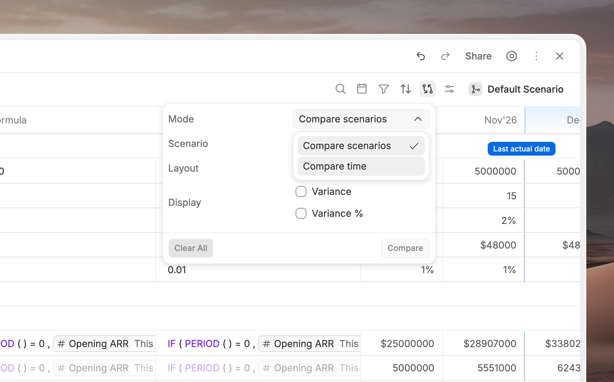

Compare tools let you evaluate planning outputs across scenarios and time periods. Use them when the decision depends on context: one planning branch versus another, forecast versus budget, or growth over time.

Comparisons work across models and boards so the same question stays readable as you move between surfaces.

<Frame caption="Compare controls on a model">
  
</Frame>

## In this section

<Columns cols={2}>
  <Card title="What is a compare" icon="circle-question-mark" href="/concepts/analysis-and-reporting/compare/what-is-a-compare">
    Types of comparisons and when to use them.
  </Card>
  <Card title="Scenario compare" icon="split" href="/concepts/analysis-and-reporting/compare/scenario-compare">
    Compare scenarios side by side with variances.
  </Card>
  <Card title="Time compare" icon="clock" href="/concepts/analysis-and-reporting/compare/time-compare">
    Compare periods such as current versus prior.
  </Card>
</Columns>

For scenario ownership, locking, and merge workflows, see [Scenarios](/concepts/modeling/scenarios). For preparing a focused slice before you compare, see [Compare in views](/concepts/analysis-and-reporting/views/compare-in-views).
