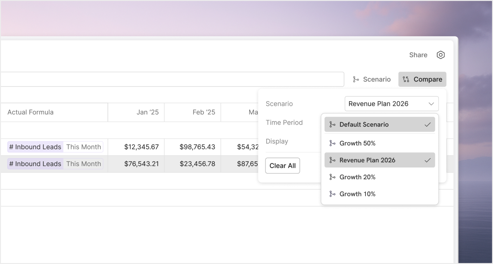

Scenario compare works like time compare, but you compare scenarios rather than time periods. Use it to evaluate your Default Scenario against one or more alternative scenarios.

This page is the canonical home for scenario comparison in Concepts. Scenario create, lock, and merge guidance stays under [Scenarios](/concepts/modeling/scenarios).

<Frame caption="Scenario comparison">
  
</Frame>

## What scenario compare is for

Compare is most useful when it supports an actual decision.

Common examples include:

- current forecast versus approved budget
- working scenario versus Default Scenario
- a draft case versus a locked baseline
- one departmental assumption versus another

## Start with the right baseline

A comparison only feels useful when the baseline is clear.

In most cases, the right starting points are:

- **Default Scenario** as the shared default branch
- a locked or approved scenario used as a stable checkpoint

If the baseline itself is unclear, the comparison quickly becomes noisy.

## Overview of the comparison

You can compare the Default Scenario with one or more scenarios. This helps with:

- What-if analysis
- Forecast versus budget
- Evaluating the impact of different strategic decisions

## Comparing in models

In models, scenario comparison creates additional columns similar to time compare:

- Each scenario is displayed in its own column or group of columns.
- You can view variances between scenarios to understand the impact of different assumptions.

## Comparing on board charts

Board charts for scenario comparison work like time compare:

- Data is visualized using bars or lines.
- You can compare the same metric across multiple scenarios in a single chart.

## Keep the comparison focused

Good comparisons stay narrow enough to tell a story.

Start with:

- the few metrics that drive the decision
- the time periods that matter
- the dimensions that explain the variance

If too many unrelated changes are mixed together, the result becomes hard to interpret and harder to merge safely later.

## Compare before governance actions

Compare is especially helpful before:

- merging a scenario
- locking a scenario as an approved baseline
- deleting or retiring an older branch

That is often the last moment to confirm the branch still means what the team thinks it means.

For merge and lock workflows, see [Scenarios](/concepts/modeling/scenarios) and Legacy [Merge scenarios](/concepts/modeling/scenarios/merge-scenarios) until those pages migrate.

## Related pages

- [What is a compare](/concepts/analysis-and-reporting/compare/what-is-a-compare)
- [Time compare](/concepts/analysis-and-reporting/compare/time-compare)
- [What is a scenario](/concepts/modeling/scenarios/what-is-a-scenario)
- [Compare in views](/concepts/analysis-and-reporting/views/compare-in-views)
- [Scenario best practices](/concepts/modeling/scenarios/scenario-best-practices)
