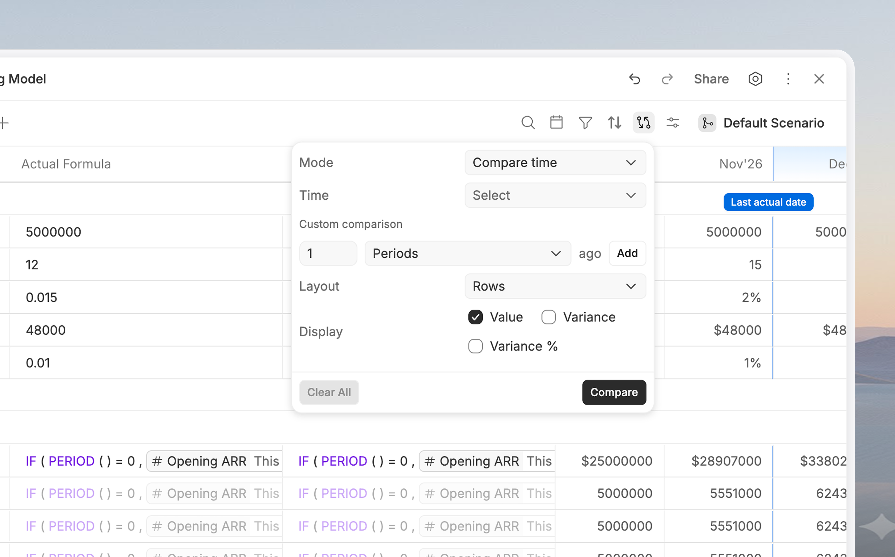

Time compare lets you compare models, boards, Transactions, and dimensions across different time periods. You can analyze current performance against historical data, such as the previous period or earlier months.

<Frame caption="Compare time settings on a model">
  
</Frame>

## Overview

You can compare the current period with one or more time periods at once. This is useful for:

- Tracking growth trends (MoM, QoQ, YoY)
- Identifying seasonal patterns
- Monitoring performance against historical benchmarks

## Comparing in models

In models, you can visualize time comparisons directly in the grid:

- **Rows and columns** — Display comparisons in rows or columns depending on your layout preference.
- **Variances** — Enable or disable **Variance** and **Variance %** calculations to see absolute and relative differences between periods.

Open **Compare**, set **Mode** to **Compare time**, choose the periods to compare, set **Layout**, and pick what to show under **Display**.

## Comparing on board charts

On board charts, time comparisons are typically visualized as:

- **Bar / column charts** — Grouped bars showing data side by side for different periods
- **Line charts** — Multiple lines representing different periods over time

Switch visualizations when you need a clearer story for the audience.

## Related pages

- [What is a compare](/concepts/analysis-and-reporting/compare/what-is-a-compare)
- [Scenario compare](/concepts/analysis-and-reporting/compare/scenario-compare)
- [Relative time](/concepts/data-and-structure/time/relative-time)
- [Charts](/concepts/analysis-and-reporting/boards/charts)
