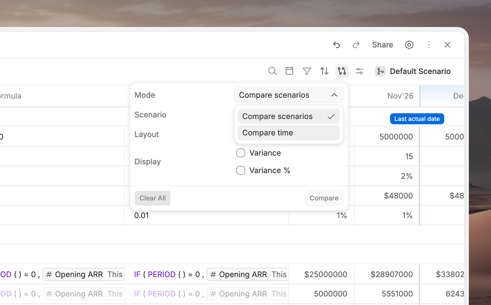

Comparison tools in Oculon let you evaluate data across planning states and time. Whether you are comparing budget to actuals or looking at period-over-period growth, comparisons provide the context needed to make informed decisions.

<Frame caption="Compare mode on a model">
  
</Frame>

## Types of comparisons

Oculon offers two main ways to compare your data:

- **[Scenario compare](/concepts/analysis-and-reporting/compare/scenario-compare)** — Compare different versions of your data, such as your Default Scenario versus an alternate forecast.
- **[Time compare](/concepts/analysis-and-reporting/compare/time-compare)** — Analyze data across periods, such as current month versus previous month.

## Key features

- **Dynamic variances** — Calculate absolute and percentage variances between comparison points.
- **Multi-scenario / multi-period support** — Compare your current view with one or more other scenarios or periods.
- **Consistent visuals** — Comparisons work across models and boards so the experience stays familiar.

## Why use comparisons

In FP&A, data is most valuable when viewed in context. Comparisons help you:

- Evaluate the impact of different scenarios
- Identify trends over time
- Explain variances between expected and actual results

## Related pages

- [Scenario compare](/concepts/analysis-and-reporting/compare/scenario-compare)
- [Time compare](/concepts/analysis-and-reporting/compare/time-compare)
- [Compare in views](/concepts/analysis-and-reporting/views/compare-in-views)
- [What is a scenario](/concepts/modeling/scenarios/what-is-a-scenario)
