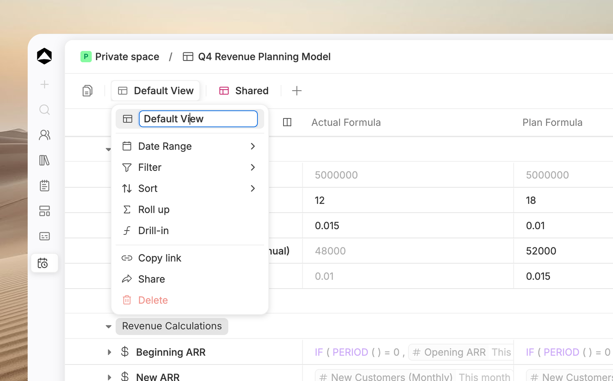

A view is a saved way to look at a model or Transactions dataset. It narrows the source to the content that matters for one workflow, audience, or decision.

You work with views from the views bar on models and Transactions, and you can reuse saved slices when you report.

<Frame caption="Views bar and view menu on a model">
  
</Frame>

## In this section

<Columns cols={2}>
  <Card title="What is a view" icon="circle-question-mark" href="/concepts/analysis-and-reporting/views/what-is-a-view">
    How views stay connected to their source.
  </Card>
  <Card title="Creating and configuring views" icon="sliders-horizontal" href="/concepts/analysis-and-reporting/views/creating-and-configuring-views">
    Create a view and save the setup that matters.
  </Card>
  <Card title="Filters, sorts, and grouping" icon="funnel" href="/concepts/analysis-and-reporting/views/filters-sorts-and-grouping">
    Shape what a view shows without changing the source.
  </Card>
  <Card title="Compare in views" icon="split" href="/concepts/analysis-and-reporting/views/compare-in-views">
    Use a focused view before you interpret variances.
  </Card>
  <Card title="View best practices" icon="badge-check" href="/concepts/analysis-and-reporting/views/view-best-practices">
    Keep views clear, reusable, and maintainable.
  </Card>
</Columns>
