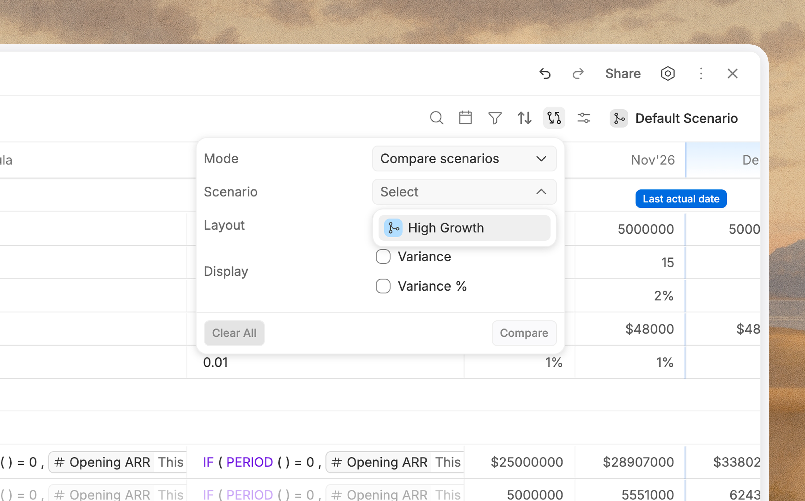

Views are often the easiest place to prepare a comparison because they let you narrow the data before you ask for a variance.

For the full comparison workflow across models and boards, use [Compare](/concepts/analysis-and-reporting/compare/what-is-a-compare). This page covers how views help you set context before you compare.

<Frame caption="Compare scenarios from a model view">
  
</Frame>

## Start with model views

Model views are usually the best place to prepare comparisons such as:

- scenario versus scenario
- actual versus forecast
- current period versus prior period
- one dimension slice versus another

From the views toolbar, open compare and choose **Compare scenarios**, pick the scenario to stack against the current one, and optionally show **Variance** or **Variance %**.

Deep scenario and time comparison controls live under [Scenario compare](/concepts/analysis-and-reporting/compare/scenario-compare) and [Time compare](/concepts/analysis-and-reporting/compare/time-compare).

## Use Transactions views only when the slice is clear

A Transactions view can still support comparison when the structure already gives you a clean slice to review, such as one category versus another or one filtered record set versus another. Do not assume a Transactions view supports model-style scenario comparison.

## Keep the context stable

Compare one business question at a time. Lock the right filters, grouping, and time context before you interpret the result.

## Check the source before you debug

If a comparison looks wrong, confirm the active scenario, [Time aggregation](/concepts/data-and-structure/time/time-aggregation), [Time rollups](/concepts/data-and-structure/time/time-aggregation), and filters before you assume the formula or data is incorrect.

## Related pages

- [Filters, sorts, and grouping](/concepts/analysis-and-reporting/views/filters-sorts-and-grouping)
- [Scenario compare](/concepts/analysis-and-reporting/compare/scenario-compare)
- [Using views on boards](/concepts/analysis-and-reporting/boards/tables-on-boards)
