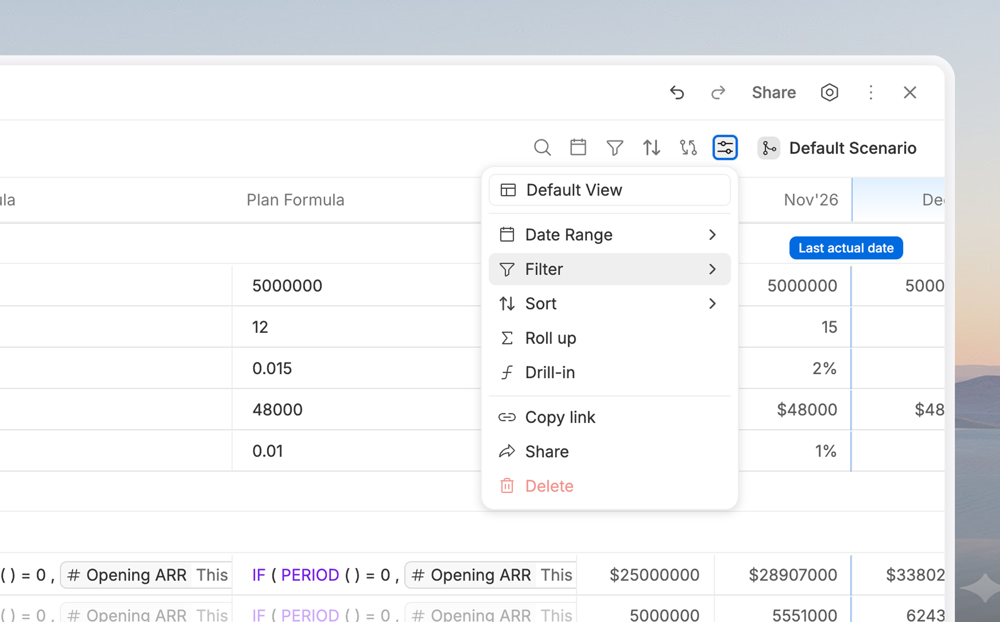

A good view starts with a clear question. Decide what the audience needs to see before you save filters or layout choices.

<Frame caption="Configuring a view from the views toolbar">
  
</Frame>

## Start from the right source

Create the view on the model or Transactions dataset that already contains the content you need.

- Use a **model view** when the question depends on planning logic, scenarios, dimensions, or time-aware outputs.
- Use a **Transactions view** when the question depends on source records or operational detail.

## Save the configuration that matters

A view can save choices such as:

- Filters
- Sort order
- Grouping
- Visible content
- Time or scenario context where the source supports it

Open the view menu from the views bar or the sliders control on the toolbar to set **Date Range**, **Filter**, **Sort**, **Roll up**, and **Drill-in**. The exact options depend on whether the view comes from a model or from Transactions. For filter, sort, and grouping concepts on views, see [Filters, sorts, and grouping](/concepts/analysis-and-reporting/views/filters-sorts-and-grouping). For the same controls while reviewing Transactions records directly, see [Filters, sorts, and grouping (Transactions)](/concepts/data-and-structure/transactions/filters-sorts-and-grouping).

## Name the view for reuse

Name the view after the workflow, audience, or business question it supports. That makes it easier to reuse on boards, in reviews, and when you send someone a link to the right slice.

## Keep setup separate from source design

If a view needs too many rules to make sense, first check whether the model structure or Transactions structure needs cleanup.

## Related pages

- [What is a view](/concepts/analysis-and-reporting/views/what-is-a-view)
- [Filters, sorts, and grouping](/concepts/analysis-and-reporting/views/filters-sorts-and-grouping)
- [View best practices](/concepts/analysis-and-reporting/views/view-best-practices)
