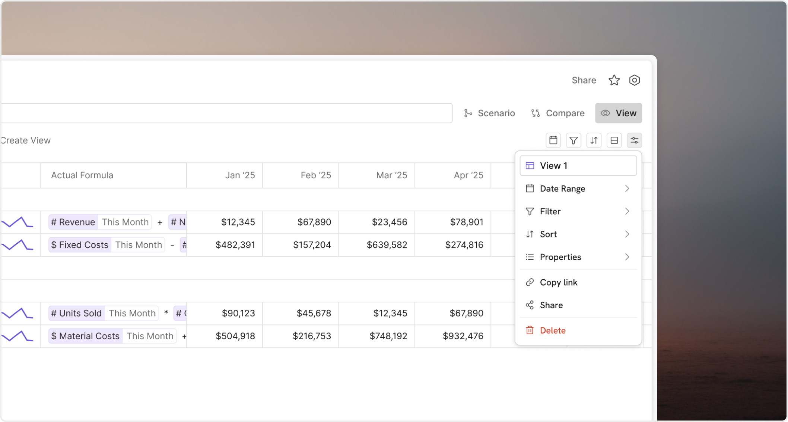

A view becomes useful when its saved setup matches the question you are trying to answer.

<Frame caption="View filter controls">
  
</Frame>

## Use filters to narrow the question

Use filters to keep only the content that matters.

- Model views may filter variables, dimensions, scenarios, time periods, or visuals.
- Transactions views may filter records, fields, categories, or date-based slices.

## Use sorting to surface priority

Use sorting to make the result easier to scan. Choose an order that highlights the rows, variables, or groups people need to review first.

## Use grouping to add structure

Grouping helps when the audience needs shared structure, such as review by department, product family, status, or owner.

## Expect options to differ by source

The available filters and grouping rules depend on whether the view comes from a model or from Transactions. Start with the business question, then use only the controls that make that answer clearer.

For source-level Transactions review controls outside saved views, see [Filters, sorts, and grouping](/concepts/data-and-structure/transactions/filters-sorts-and-grouping).

## Keep the setup readable

A view should feel intentional. If it needs too many hidden rules to make sense, the underlying model or reporting approach may need cleanup.

## Related pages

- [Creating and configuring views](/concepts/analysis-and-reporting/views/creating-and-configuring-views)
- [Compare in views](/concepts/analysis-and-reporting/views/compare-in-views)
- [What is a view](/concepts/analysis-and-reporting/views/what-is-a-view)
