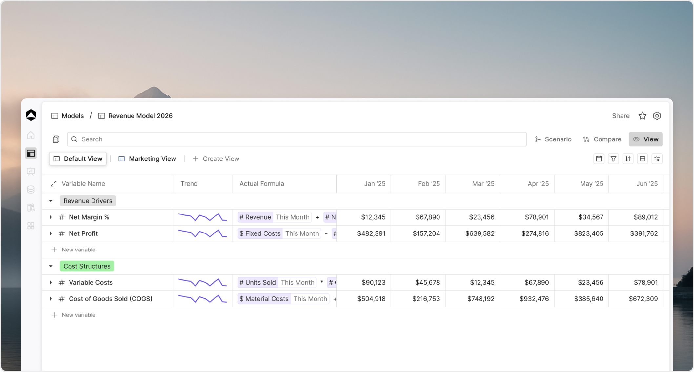

A view is a saved way to look at a model or Transactions dataset in Oculon. It narrows the source to the content that matters for one workflow, audience, or decision.

<Frame caption="Views panel">
  
</Frame>

## Why views matter

Views let you reuse the same source in different ways. You can keep one model or Transactions dataset as the source of truth and create focused review surfaces without rebuilding the underlying logic or records.

## A view stays connected to its source

A view is not a disconnected copy. If the source model or Transactions dataset changes, the view reflects the current state through the filters, grouping, and display rules you saved.

That connection is powerful for collaboration. It also means views need clear ownership so people know who should update them when the underlying source evolves.

## Where views fit

Use a view when you want to:

- narrow a model to the right variables, dimensions, scenarios, or time periods
- narrow Transactions to the right records or fields
- reuse a saved slice in reporting workflows

For create and configuration detail, see [Creating and configuring views](/concepts/analysis-and-reporting/views/creating-and-configuring-views).

## Related pages

- [Creating and configuring views](/concepts/analysis-and-reporting/views/creating-and-configuring-views)
- [Filters, sorts, and grouping](/concepts/analysis-and-reporting/views/filters-sorts-and-grouping)
- [Compare in views](/concepts/analysis-and-reporting/views/compare-in-views)
- [Sharing views](/concepts/analysis-and-reporting/views/sharing-views)
- [Using views on boards](/concepts/analysis-and-reporting/boards/tables-on-boards)
