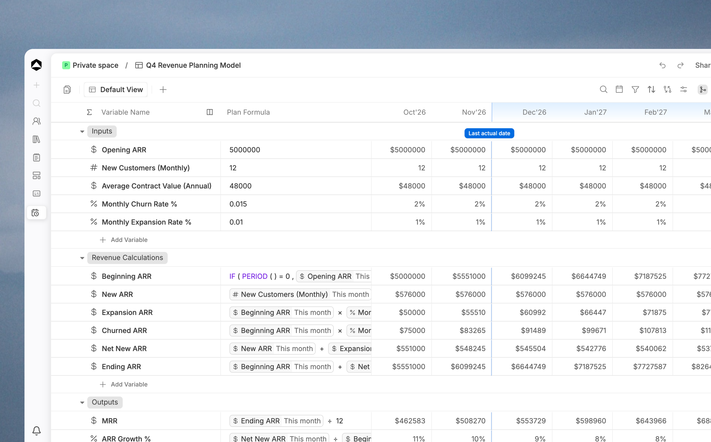

Oculon is a planning and analysis platform for finance teams. You build driver-based models, connect them to your actual financial data, and share the results with the people who make decisions. Everything runs in one workspace, so you don't pass spreadsheet files between teams.

<Frame caption="A revenue planning model in Oculon">
  
</Frame>

## What Oculon helps you do

Finance teams use Oculon for recurring planning work, such as:

- Budgets and rolling forecasts
- Revenue, headcount, and cost planning
- Actual-versus-plan and variance reviews
- What-if analysis before a decision
- Board and management reporting

## What you work with

- **Create.** You build models from variables and formulas. A variable can be a driver, an assumption, or a calculated result such as `Gross Profit`. You break variables down by shared categories such as `Region` or `Product`.
- **Connect.** You bring source records into Transactions from an integration, from an uploaded spreadsheet, or by entering them yourself. Models use that data as actuals.
- **Analyze.** You test alternatives in scenarios and compare scenarios or time periods side by side. Saved views let you focus on the part of a model you care about.
- **Collaborate.** You share work in teamspaces and give people access to individual items. You can also present results on boards.

An AI assistant is available throughout the product. It can help you build models, answer questions, and prepare reports.

## How Oculon differs from spreadsheets

In a spreadsheet, structure, logic, and access are spread across files and tabs. In Oculon, each variable is defined once, and reports read from that one definition. The [Last actual date](/concepts/data-and-structure/time/last-actual-date) separates actual from planned periods, so you don't maintain separate actuals and forecast copies. Permissions apply to each item, not to an emailed file.

## Related

- [How Oculon is organized](/concepts/core-concepts/how-oculon-is-organized)
- [Core concepts overview](/concepts/core-concepts/core-concepts-overview)
- [How data flows through Oculon](/concepts/core-concepts/how-data-flows-through-oculon)
- [Glossary](/concepts/core-concepts/glossary)
