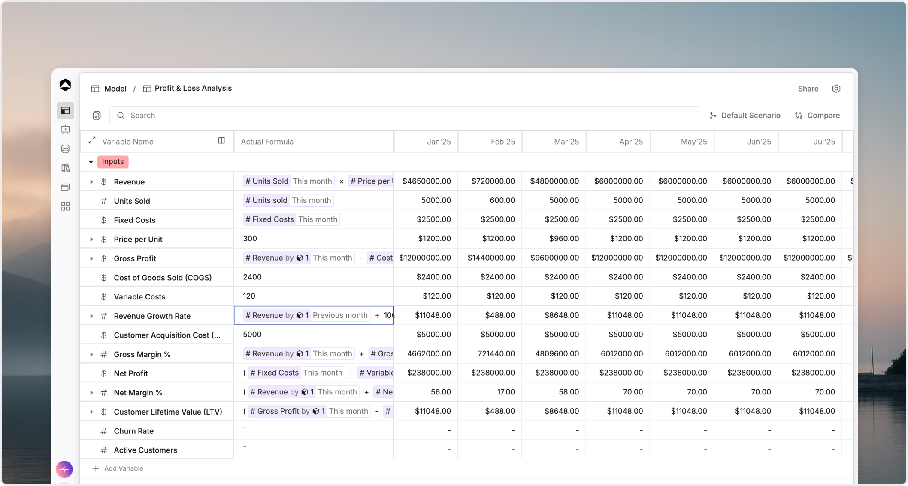

Oculon is a planning and analysis workspace for teams that need one place to model, review, and share business decisions. You can build driver-based models, connect source data, compare scenarios, and present results without moving work between disconnected spreadsheets.

<Frame caption="Oculon">
  
</Frame>

## What you can do in Oculon

- Build [models](/concepts/modeling/models) with [variables](/concepts/data-and-structure/variables), [dimensions](/concepts/data-and-structure/dimensions), [time](/concepts/data-and-structure/time) logic, and [formulas](/concepts/modeling/formulas)
- Bring in source data through [Transactions](/concepts/data-and-structure/transactions) and integrations
- Test assumptions in [scenarios](/concepts/modeling/scenarios) before you adopt changes
- Review results in [views](/concepts/analysis-and-reporting/views), [Compare](/concepts/analysis-and-reporting/compare), and [boards](/concepts/analysis-and-reporting/boards)
- Use [AI](/concepts/ai-and-agents/ai-overview) for modeling and reporting help inside the same workspace

## How Oculon differs from a spreadsheet-only workflow

Oculon keeps structure, calculation logic, and permissions in one system. You can reuse the same variables across reports, keep actuals and forecast logic aligned around the [Last actual date](/concepts/data-and-structure/time/last-actual-date), and let teammates work in the same model without passing files around.

## Where most teams start

1. Create or open a [workspace](/concepts/workspace-and-collaboration/workspaces)
2. Build a model with a clear date range and Last actual date
3. Add variables and any dimensions you need
4. Connect source data or create Transactions
5. Review the result in views and boards

## When to use Oculon

Use Oculon when you need repeatable planning, controlled collaboration, and a clear record of what changed. It works best when the same model needs to support both day-to-day analysis and decision-ready reporting.

## Related pages

- [How Oculon is organized](/concepts/core-concepts/how-oculon-is-organized)
- [Core concepts overview](/concepts/core-concepts/core-concepts-overview)
- [How data flows through Oculon](/concepts/core-concepts/how-data-flows-through-oculon)
- [Glossary](/concepts/core-concepts/glossary)
