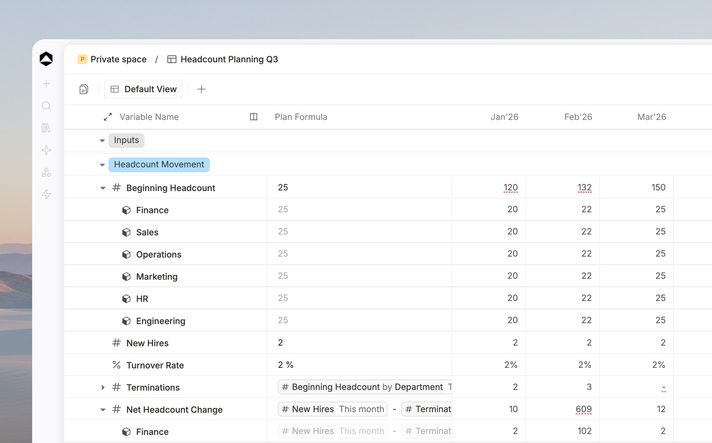

Dimensions are shared categories, such as `Region`, `Product`, or `Department`, that you use to break one metric into business slices. They belong to the whole workspace, and you manage them from **Library** → **Dimensions**.

<Frame caption="Headcount broken down by a Department dimension">
  
</Frame>

## In this section

<Columns cols={2}>
  <Card title="What is a dimension" icon="circle-question-mark" href="/concepts/data-and-structure/dimensions/what-is-a-dimension">
    What dimensions are, where they live, and how they connect to models and Transactions.
  </Card>
  <Card title="Create and edit dimensions" icon="circle-plus" href="/concepts/data-and-structure/dimensions/create-and-edit-dimensions">
    Create a dimension from the Library, a model, or Transactions.
  </Card>
  <Card title="Dimension values" icon="list" href="/concepts/data-and-structure/dimensions/dimension-values">
    Add, rename, reorder, and delete the values in a dimension.
  </Card>
  <Card title="Using dimensions with variables" icon="link" href="/concepts/data-and-structure/dimensions/using-dimensions-with-variables">
    Link a dimension to a model and break a variable down by it.
  </Card>
  <Card title="Dimension operations" icon="settings" href="/concepts/data-and-structure/dimensions/dimension-operations">
    Add variable, dimension, and property columns, and save dimension views.
  </Card>
  <Card title="Dimension best practices" icon="badge-check" href="/concepts/data-and-structure/dimensions/dimension-best-practices">
    Keep dimensions clear and reusable over time.
  </Card>
</Columns>
