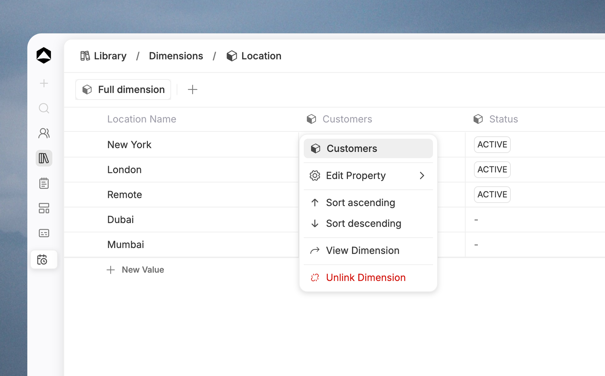

You can create a dimension from the Library, from inside a model, or while you set up Transactions. Every dimension you create belongs to the workspace, so other models can reuse it.

{/* TODO: screenshot of the current Library Dimensions tab with the Create menu open. Existing fr-dimension-list.png shows an older Libraries layout. */}

## Create a dimension

- **From the Library.** Open **Library** → **Dimensions**, click **Create**, and choose **Create Dimension**. The new dimension page opens so you can add values.
- **From a variable.** In a model, open a variable's **Breakdown by** menu and click **Add Dimension**. Type a name and choose **New Dimension**. Oculon creates the dimension, links it to the model, and breaks the variable down by it.
- **From a model.** In the model's left panel, click **Add Dimension** next to **Dimension**. You can link an existing dimension or create a new one.
- **From Transactions.** When you add a **Segment by** field, you can map it to an existing dimension or create a new one.

Before you create a dimension, search the Library for an existing one. Reusing a dimension keeps categories consistent across models.

## Edit a dimension

Open the dimension from **Library** → **Dimensions**. On the dimension page, you can:

- Add, rename, reorder, and delete values. See [Dimension values](/concepts/data-and-structure/dimensions/dimension-values).
- Add variable columns, columns that link to other dimensions, or property columns. See [Dimension operations](/concepts/data-and-structure/dimensions/dimension-operations).
- Create and switch between views of the dimension.
- Click a column header to edit the column. For a linked dimension column, the menu offers **Edit Property**, **Sort ascending**, **Sort descending**, **View Dimension**, and **Unlink Dimension**.

<Frame caption="Editing a column on a dimension page">
  
</Frame>

## Edit with care

A dimension is shared across the workspace. Renaming or deleting a value changes it in every model, Transactions, and board that uses the dimension. Check where the dimension is used before you make structural changes.

## Related

- [What is a dimension](/concepts/data-and-structure/dimensions/what-is-a-dimension)
- [Dimension values](/concepts/data-and-structure/dimensions/dimension-values)
- [Dimension operations](/concepts/data-and-structure/dimensions/dimension-operations)
- [Using dimensions with variables](/concepts/data-and-structure/dimensions/using-dimensions-with-variables)
