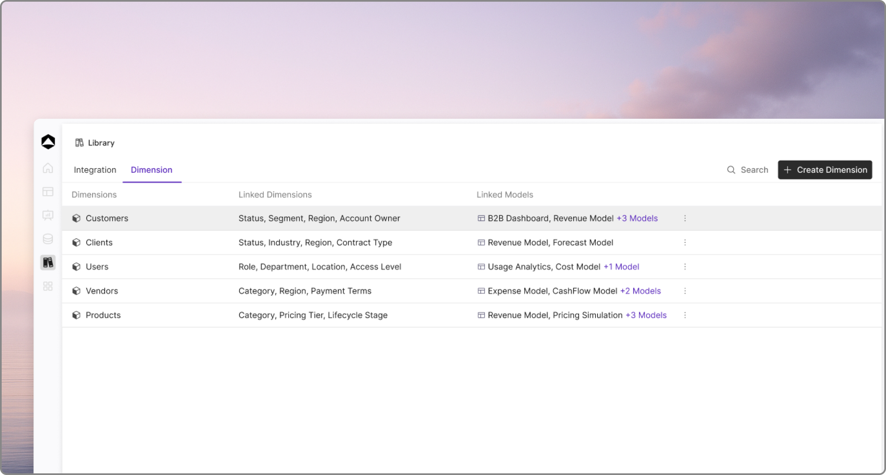
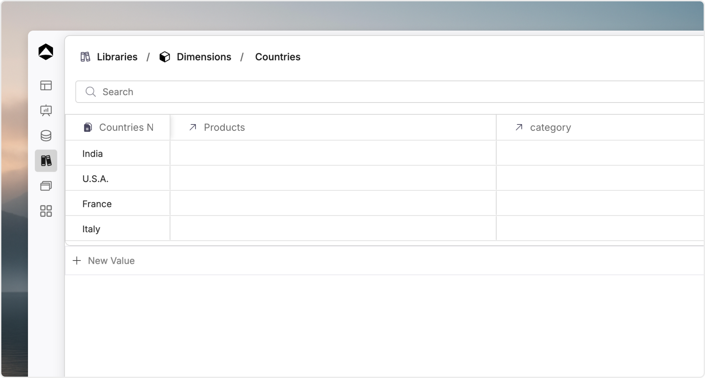

You can create dimensions from the Library or while you work in a model. Setting them up carefully keeps breakdowns consistent wherever you reuse them.

## Where to create a dimension

<Frame caption="Dimensions list in the Library">
  
</Frame>

There are two primary ways to create a new dimension:

- **From the Library**: Open **Library** → **Dimensions**, then choose **Create Dimension** to create and manage the dimension centrally.
- **From a model**: While you work with a variable, use **Add Dimension** (including the **Breakdown by** flow) to attach an existing dimension or create one as you build the model.

## Add and edit values

After you create a dimension, open it from the Library to manage its values. Use **+ New Value** to add members, then rename them to match your business language.

Add as many values as you need. Prefer stable names so formulas, filters, and boards stay readable as the model grows.

## The dimension details page

<Frame caption="Dimension details page">
  
</Frame>

From the dimension details page, you can:

- **Add values**: Continue adding members with **+ New Value**.
- **Add columns**: Add columns for properties or relationships, including a **Linked dimension** or **Lookup**. This lets you store extra context about members or map dimensions to each other.

## Related

- [Dimension values](/concepts/data-and-structure/dimensions/dimension-values)
- [Dimension operations](/concepts/data-and-structure/dimensions/dimension-operations)
