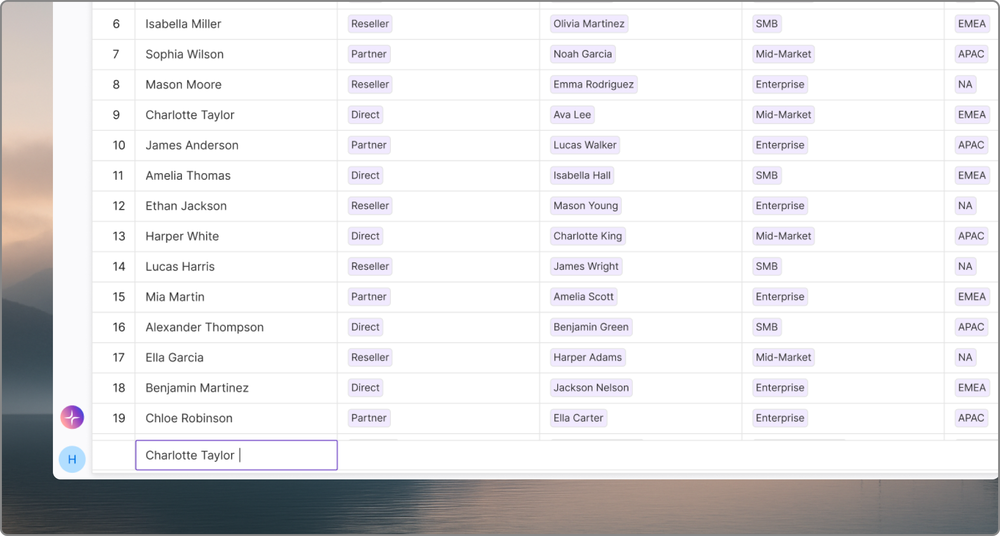
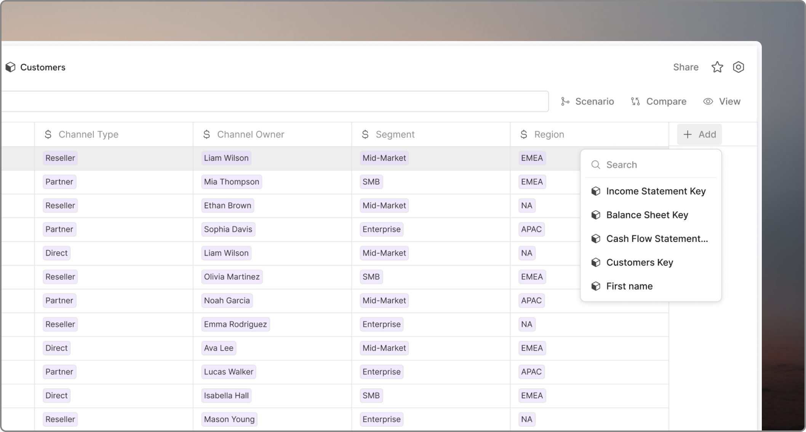
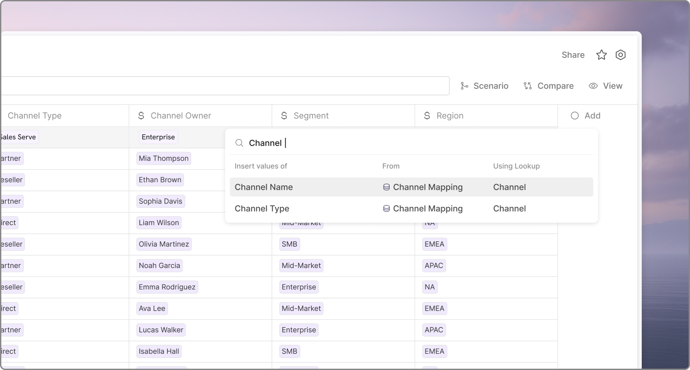
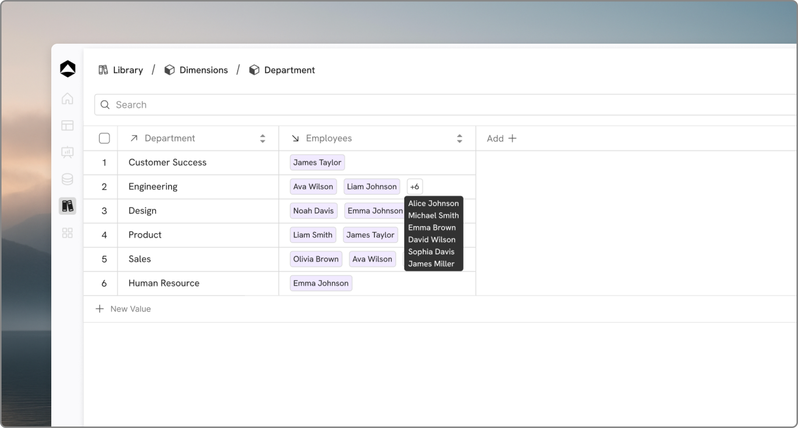

Dimension operations are the actions you use to keep a dimension clean, accurate, and useful over time.

## Adding and editing dimension values

<Frame caption="Adding values in a dimension">
  
</Frame>

You manage members directly in the dimension view:

- **Add values**: Use **+ New Value** at the bottom of the list, or insert a value between existing items.
- **Edit values**: Click into a cell to rename a value or update its properties.

## Linking dimensions

<Frame caption="Adding a linked dimension column">
  
</Frame>

Dimensions can be connected with columns so members relate to members in another dimension.

- **Create links**: Add a **Linked dimension** column on a base dimension to establish the relationship.
- **Example**: On an **Employee** dimension, add a **Department** linked dimension column so each employee maps to a department.

## Dimension lookups

<Frame caption="Lookup columns across linked dimensions">
  
</Frame>

Lookups fill values automatically from relationships you already defined.

- **Chain links**: Create a **Lookup** column that spans multiple links. For example, if **Employee** links to **Department**, and **Department** links to **Entity**, the Employee dimension can look up **Entity** from the linked department.
- **Automatic sync**: When an employee's department changes, associated lookup columns (such as Entity) update to match.

## Multiple dimension values and relationships

<Frame caption="Mapping multiple values between dimensions">
  
</Frame>

Depending on how you configure columns, members can map in different ways:

- **Many-to-one**: Multiple items in one dimension map to a single item in another. This is the most common relationship.
  - *Example*: Mapping multiple **Sales Reps** to a single **Sales Region**.
- **One-to-one**: One item maps strictly to one other item.
  - *Example*: Mapping an **Employee ID** uniquely to a **Cost Center**.
- **One-to-many**: A single item maps to multiple values.
  - *Example*: A single **Marketing Campaign** that spans multiple **Advertising Channels**.

## Edit with caution

If a dimension is already used in models or boards, changing the structure can affect formulas, filters, and saved views. Make structural changes carefully and review the downstream impact.

## Use operations to reduce clutter

Do not keep unused values, duplicate categories, or temporary naming in a production dimension. Clean dimensions make filtering and comparison much easier.

## Related

- [Dimension values](/concepts/data-and-structure/dimensions/dimension-values)
- [Create and edit dimensions](/concepts/data-and-structure/dimensions/create-and-edit-dimensions)
