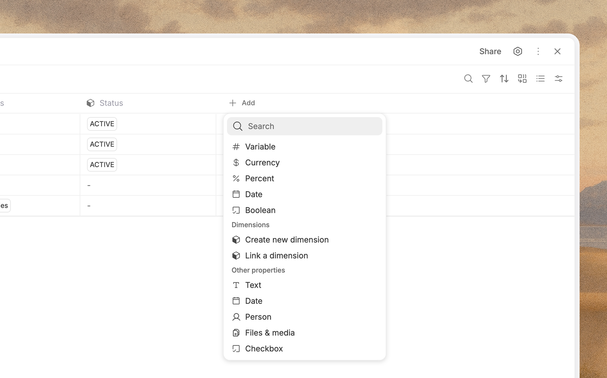
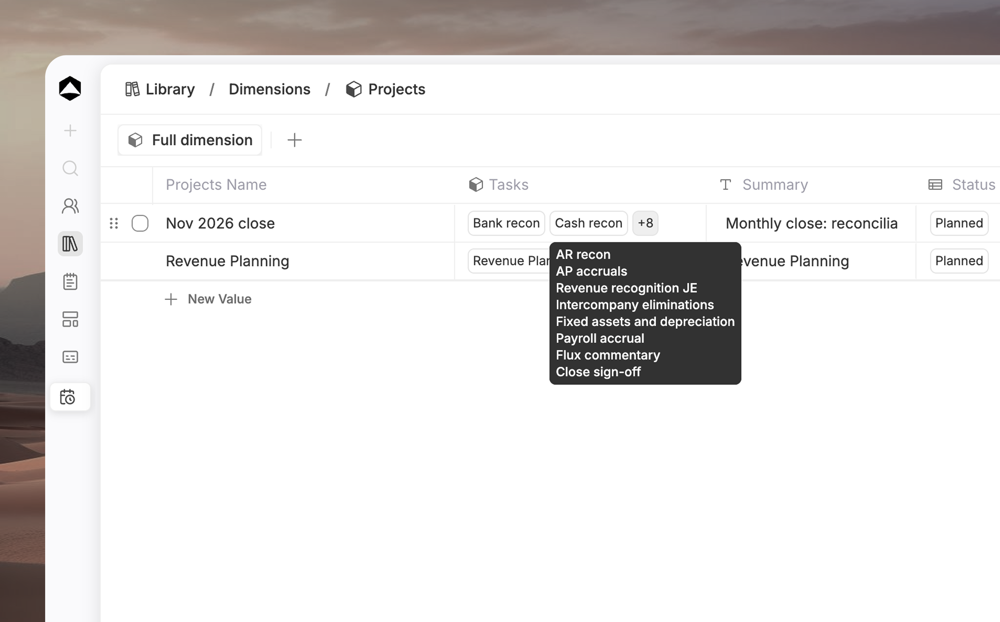

Beyond its values, a dimension can store numbers, relationships, and other details about each value. For example, a `Location` dimension can hold a `Monthly Rent` amount for each office, link each office to the `Customers` it serves, and record who manages it. This page covers the columns and views you use to set that up.

## Add a column

Open the dimension page and click **+ Add** at the end of the column headers. The menu groups column types into three kinds:

| Group | Options | Use it for |
| :--- | :--- | :--- |
| Variables | **Variable**, **Currency**, **Percent**, **Date**, **Boolean** | Values you track for each dimension value, such as `Monthly Rent` or `Target Margin` |
| Dimensions | **Create new dimension**, **Link a dimension** | Relating each value to values in another dimension |
| Other properties | **Text**, **Date**, **Person**, **Files & media**, **Checkbox** | Descriptive details, such as a note, an owner, or a contract file |

Use the search box at the top of the menu to find a column type quickly.

<Frame caption="The Add column menu on a dimension">
  
</Frame>

## Add variables

A variable column stores a value for each dimension value. The variable types match the types you use in models:

| Menu option | Variable type | Example |
| :--- | :--- | :--- |
| **Variable** | Number | `Headcount Target` |
| **Currency** | Currency | `Monthly Rent` |
| **Percent** | Percentage | `Target Margin` |
| **Date** | Date | `Lease End Date` |
| **Boolean** | Boolean | `Is Remote` |

See [Variable types](/concepts/data-and-structure/variables/variable-types) for how each type displays.

## Link dimensions to each other

A linked dimension column relates each value in one dimension to values in another. Linked dimensions are how you build a hierarchy, such as employees within departments within entities.

To add one, click **+ Add** and choose one of the options under **Dimensions**:

- **Link a dimension** to connect an existing dimension.
- **Create new dimension** to create the other dimension and link it in one step.

In each row, pick the linked value. For example, set `Ava Wilson` to `Engineering` in the `Department` column.

## Control how many values a row can link to

Click a linked column header and open **Edit Property** to set these options:

- **Limit.** Choose **1** when each value belongs to exactly one linked value, such as one department per employee. Choose **No Limit** when a value can link to several, such as a campaign that runs on several channels.
- **Default.** Choose a value to fill in for new rows, or **No Default**.

## See the relationship from the other side

<Frame caption="A Projects dimension showing its linked tasks">
  
</Frame>

When one dimension links to another, the other dimension shows the relationship too. For example, when tasks are linked to projects, the `Projects` dimension shows a column of the tasks in each project. If a row has more links than fit, hover the count, such as `+8`, to see the rest. The column on the other side is read-only. You edit the link in the dimension where you added the linked column.

The linked column menu also includes **View Dimension**, which opens the linked dimension, and **Unlink Dimension**, which removes the relationship.

## Add properties

Properties store descriptive details about each value that aren't values to track or another dimension. From **+ Add**, choose a type under **Other properties**:

- **Text** for notes or codes, such as an `Email ID` on an `Employee` dimension
- **Date** for a date that describes the value, such as an office opening date
- **Person** for an owner, such as the manager of each location
- **Files & media** for attachments, such as a lease agreement
- **Checkbox** for a simple yes or no marker

Use a variable column instead of a property when the value is a number, amount, or rate you want to track.

## Save views of a dimension

Like models and Transactions, a dimension can have several saved views. Each view keeps its own settings:

- **Filter** shows only the values that match your rules.
- **Sort** orders the values.
- **Group** groups values, for example by a linked dimension.
- **Properties** shows or hides columns.

From a view's menu, you can **Duplicate**, **Share**, or **Delete** it. You can't delete the default view, which shows the full dimension. When you link a dimension to a model, you choose which view the model uses. See [Using dimensions with variables](/concepts/data-and-structure/dimensions/using-dimensions-with-variables).

## Change structure with care

Variable columns, linked columns, properties, and views can be used by models, boards, and other dimensions. Before you unlink a dimension or delete a view, check what depends on it.

## Related

- [Dimension values](/concepts/data-and-structure/dimensions/dimension-values)
- [Create and edit dimensions](/concepts/data-and-structure/dimensions/create-and-edit-dimensions)
- [Dimension best practices](/concepts/data-and-structure/dimensions/dimension-best-practices)
- [Views](/concepts/analysis-and-reporting/views)
