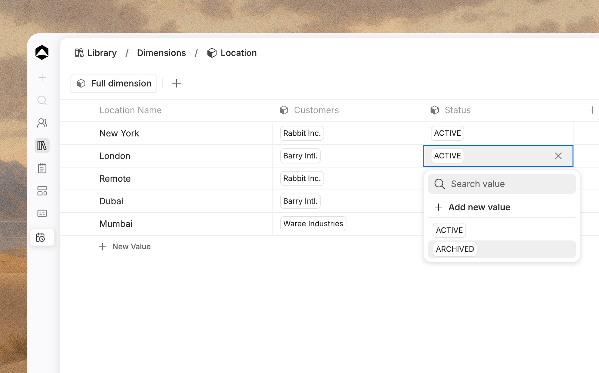
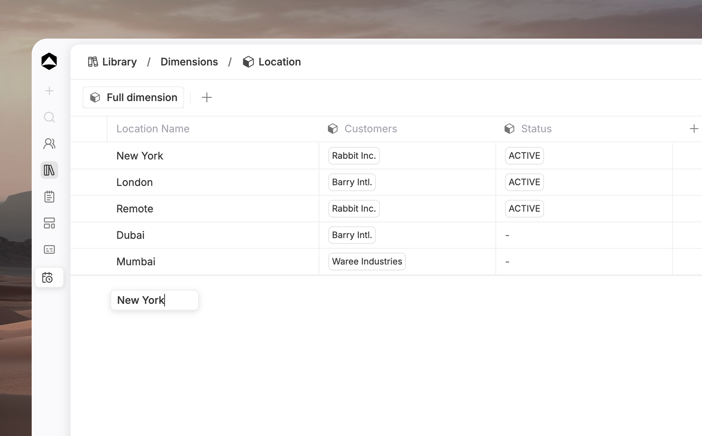

Dimension values are the individual items inside a dimension. If the dimension is `Location`, the values might be `New York`, `London`, and `Remote`. Each value becomes a row when you break a variable down by the dimension.

Values also fill the columns of other dimensions. In a linked dimension column, you pick a value for each row. If the value you need doesn't exist yet, choose **Add new value** to create it without leaving the page.

<Frame caption="Picking a value in a linked dimension column">
  
</Frame>

## What values control

Values decide which detail rows a dimensioned variable has. They also decide which options appear when you filter or group by the dimension in views and boards.

## Add values

<Frame caption="Typing a new value at the end of a dimension">
  
</Frame>

Click **+ New Value** below the list and type a name. To add a value at a specific position, select a row and choose **Insert row below**.

## Edit, reorder, and delete values

- **Rename.** Click a value and type a new name.
- **Reorder.** Drag a row to a new position, or choose **Move to top**.
- **Duplicate.** Choose **Duplicate** to copy a value.
- **Delete.** Choose **Delete** to remove a value.

You can select several rows to apply an action to all of them.

<Note>
Renaming or deleting a value affects every model, Transactions, and board that uses the dimension. Check where the dimension is used before you delete values.
</Note>

## Keep values stable

Use names that will still make sense in six months. If business terms change often, agree on naming rules first. Stable names keep formulas, filters, and reports readable.

## Related

- [What is a dimension](/concepts/data-and-structure/dimensions/what-is-a-dimension)
- [Create and edit dimensions](/concepts/data-and-structure/dimensions/create-and-edit-dimensions)
- [Dimension operations](/concepts/data-and-structure/dimensions/dimension-operations)
