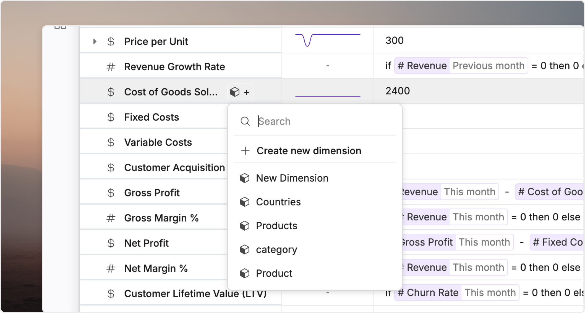
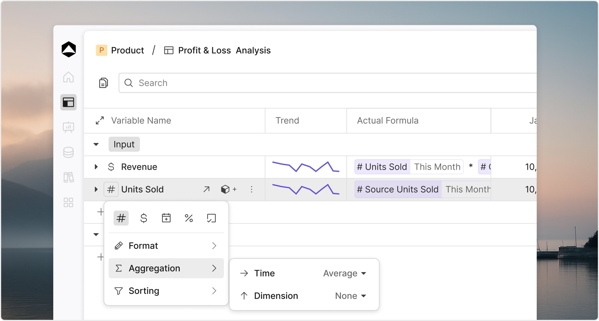
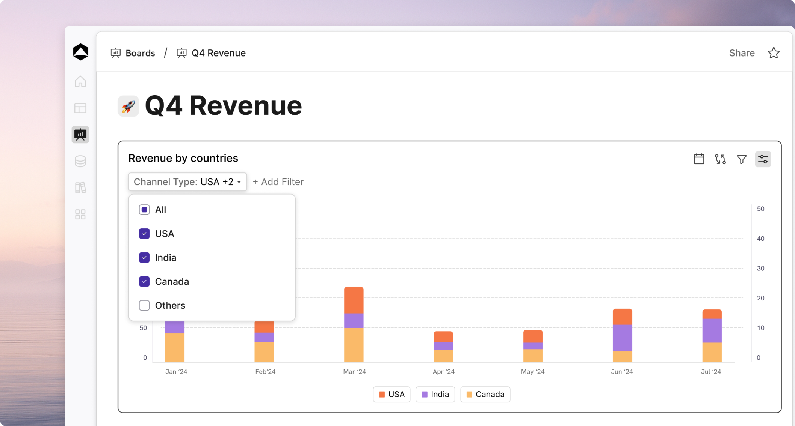

Dimensions and variables work together. A variable defines the metric. The dimension defines how that metric is broken down.

## Attach a dimension to a variable

<Frame caption="Attaching a dimension to a variable">
  
</Frame>

Attach a dimension when you want one variable to return separate values for each category. For example, one `Headcount` variable can expand into department-level rows.

In a model, open the variable's dimension controls and use **Add Dimension**. You can search for an existing Library dimension or create one as part of the **Breakdown by** flow.

## Formulas usually belong at the aggregate level

<Frame caption="Aggregate formula applied across dimension values">
  
</Frame>

In many cases, you can define the formula once at the aggregate row and let Oculon apply the logic to each dimension value. This keeps the model compact and easier to maintain.

## Watch the impact on reporting

<Frame caption="Dimensioned data on boards">
  
</Frame>

Once a variable is dimensioned, views and boards can filter and group by that dimension. This makes the model more powerful, but it also means naming and hierarchy choices matter more.

## Related

- [What is a dimension](/concepts/data-and-structure/dimensions/what-is-a-dimension)
- [Dimension best practices](/concepts/data-and-structure/dimensions/dimension-best-practices)
