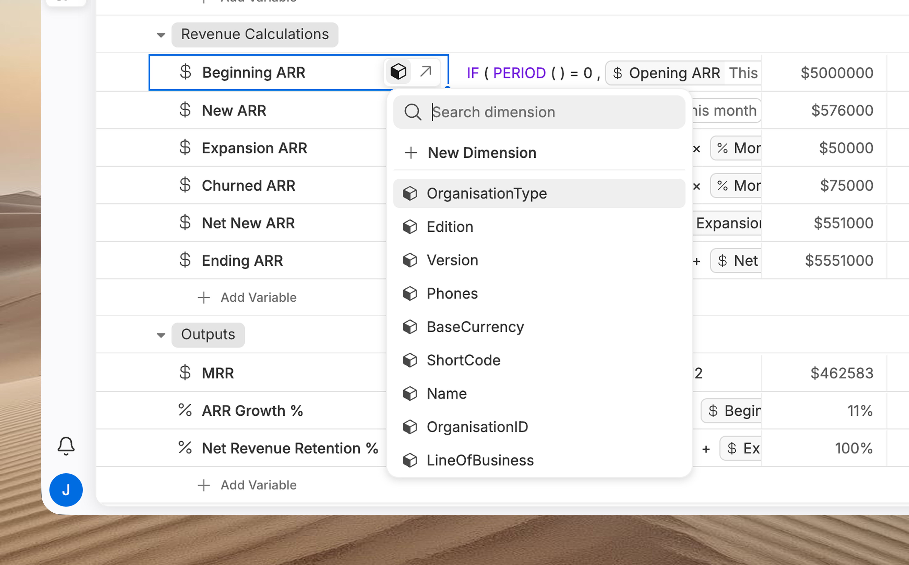
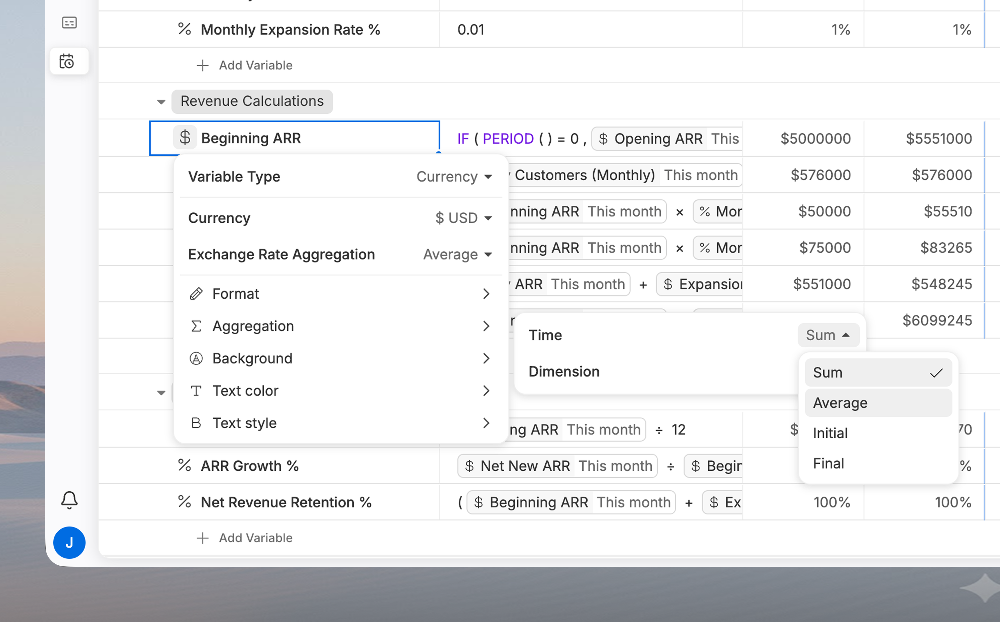
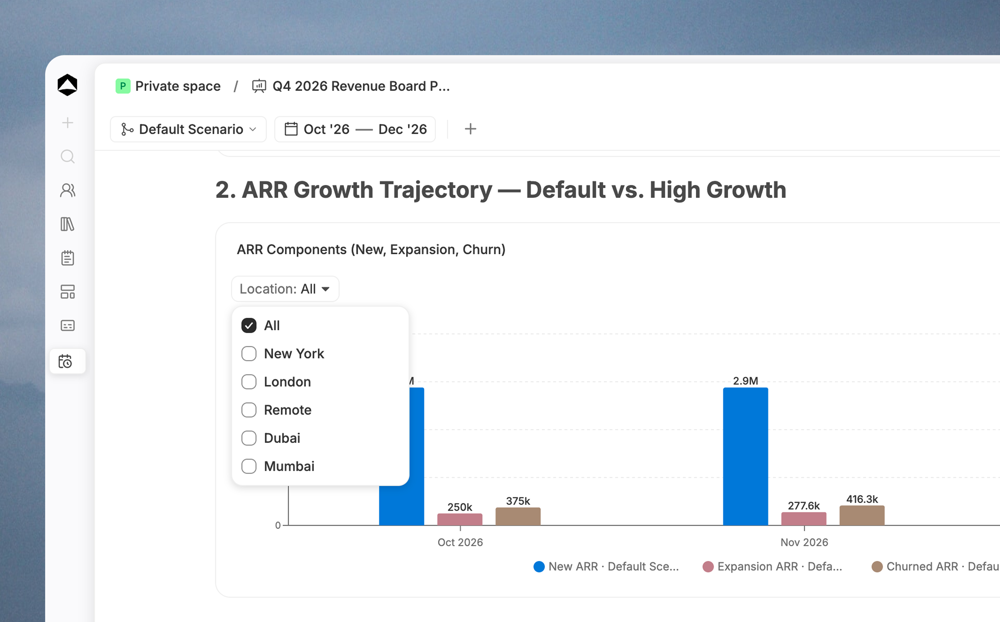

A variable defines a metric. A dimension defines how that metric is broken down. When you break a variable down by a dimension, one `Headcount` variable shows a separate row for each `Department` value.

## Link a dimension to a model

A model uses a dimension through one of the dimension's views. You link the dimension once, and every variable in the model can then use it.

1. In the model's left panel, find **Dimension**.
2. Click **Add Dimension** and search for the dimension.
3. Choose the dimension view the model should use.

Linked dimensions appear under **Dimension** in the left panel. To remove one, open its menu and choose **Unlink**.

## Break a variable down by a dimension

<Frame caption="Adding a dimension to a variable">
  
</Frame>

1. Select the variable and click the dimension icon next to its name. You can also open the variable's **Breakdown by** menu and click **Add Dimension**.
2. Search for a dimension and choose it, or click **New Dimension** to create one.

When you create a new dimension here, Oculon also links it to the model. You can add more than one dimension to a variable and drag them to change their order. For details on multi-dimension breakdowns, see [Variable breakdown](/concepts/data-and-structure/variables/variable-breakdown).

## Formulas across dimension values

You usually write a variable's formula once. Oculon evaluates it for each dimension value, so you don't maintain a formula per region or product. See [Variable behavior](/concepts/data-and-structure/variables/variable-behavior).

## Set how values combine into a total

<Frame caption="Time and dimension aggregation for a variable">
  
</Frame>

A dimensioned variable also has a total across its values. Click the variable's type icon to open its menu, then open **Aggregation** to set how that total is calculated. The **Dimension** setting controls the total across dimension values. The **Time** setting controls [time aggregation](/concepts/data-and-structure/time/time-aggregation) across periods.

## Use dimensions in reports

<Frame caption="Filtering a board chart by Location">
  
</Frame>

Once a variable is dimensioned, views and boards can filter, group, and break it down by that dimension. For example, a board chart can offer a **Location** filter, so viewers can switch between `All` and a single location such as `London`. Clear value names matter more once stakeholders see them in reports.

## Related

- [What is a dimension](/concepts/data-and-structure/dimensions/what-is-a-dimension)
- [Variable breakdown](/concepts/data-and-structure/variables/variable-breakdown)
- [Time aggregation](/concepts/data-and-structure/time/time-aggregation)
- [Dimension best practices](/concepts/data-and-structure/dimensions/dimension-best-practices)
