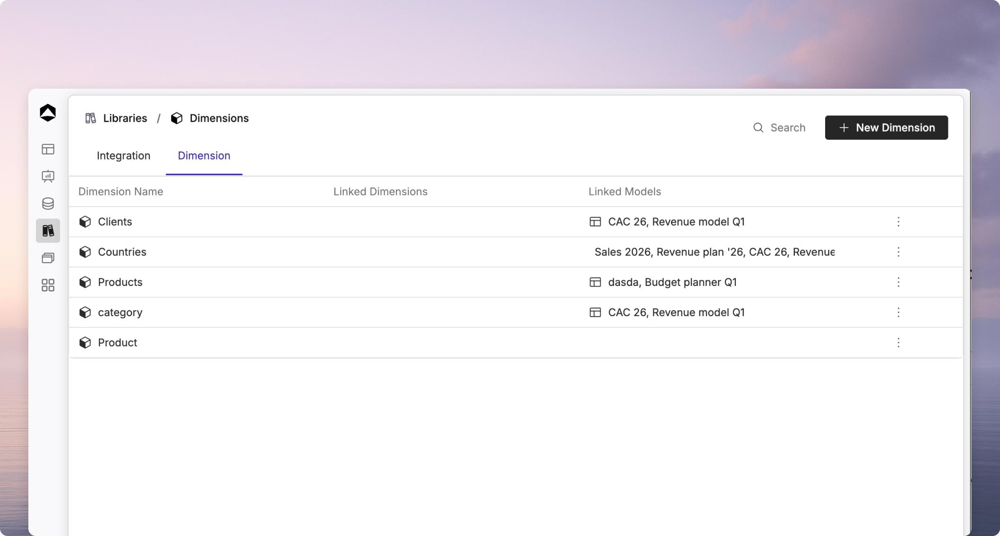

A dimension is a category you use to split the same metric into more detailed parts. Common examples include region, department, product, customer segment, or channel.

<Frame caption="A dimension as a shared business category">
  
</Frame>

## Why dimensions matter

Dimensions let you answer more specific questions without creating a separate variable for every variation. Instead of one `Revenue` line, you can keep one revenue variable and analyze it by region or product.

## Where dimensions are used

You create and manage dimensions from the Library **Dimensions** tab (`/library/dimensions`). Dimensions also appear in models, formulas, views, and boards. They are especially useful when the same planning logic should apply across many business slices.

## When to add one

Add a dimension when the breakdown changes decisions or reporting. If the detail is never reviewed and only makes the model heavier, keep the variable simple.

## Related

- [Create and edit dimensions](/concepts/data-and-structure/dimensions/create-and-edit-dimensions)
- [Using dimensions with variables](/concepts/data-and-structure/dimensions/using-dimensions-with-variables)
