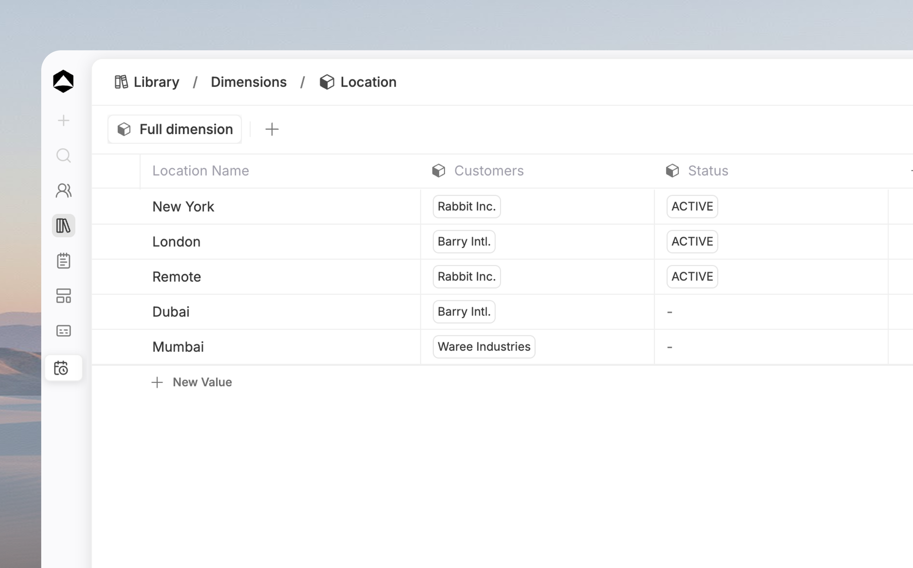

A dimension is a shared category you use to break the same metric into more detailed parts. For example, a `Location` dimension with the values `New York`, `London`, `Remote`, `Dubai`, and `Mumbai` lets one `Revenue` variable show revenue for each location.

Each dimension has its own page in the Library. Every value is a row, and columns can add details about each value, such as the customer it belongs to or its status.

<Frame caption="A Location dimension in the Library">
  
</Frame>

## Why dimensions matter

Without dimensions, you would need a separate variable for every region, product, or department. With a dimension, you keep one variable and break it down by category. Formulas, filters, and reports then work across every value of that dimension.

## Where dimensions live

Dimensions belong to the workspace, not to a space. Any model in the workspace can use the same dimension. You find and manage every dimension on the **Dimensions** tab of the **Library**.

Because a dimension is shared, a change to its values affects every model, Transactions, and board that uses it.

## What a dimension contains

- **Values.** The items in the category, such as `EMEA` and `APAC`. See [Dimension values](/concepts/data-and-structure/dimensions/dimension-values).
- **Columns.** Extra information about each value. A column can be a variable, such as a `Monthly Rent` amount, a link to another dimension, such as each `Employee` belonging to a `Department`, or a property, such as an owner or a file. See [Dimension operations](/concepts/data-and-structure/dimensions/dimension-operations).
- **Views.** Saved ways of looking at the dimension, with their own filters, sorting, and grouping.

## How dimensions connect to the rest of Oculon

- **Models.** You link a dimension to a model through one of the dimension's views. Variables in that model can then be broken down by the dimension. See [Using dimensions with variables](/concepts/data-and-structure/dimensions/using-dimensions-with-variables).
- **Transactions.** A **Segment by** field in Transactions maps a source field, such as `Region`, to a dimension. This lets models break Transactions data down by the same categories. See [What is a transaction](/concepts/data-and-structure/transactions/what-is-a-transaction).
- **Boards.** Charts and tables can break down or filter dimensioned data. You can also embed a dimension on a board with a [dimension block](/concepts/analysis-and-reporting/boards/dimension-block).

## When to add a dimension

Add a dimension when a breakdown changes decisions or reporting. If nobody reviews the detail, the extra rows only make the model heavier. In that case, keep the variable undimensioned.

## Related

- [Create and edit dimensions](/concepts/data-and-structure/dimensions/create-and-edit-dimensions)
- [Dimension values](/concepts/data-and-structure/dimensions/dimension-values)
- [Using dimensions with variables](/concepts/data-and-structure/dimensions/using-dimensions-with-variables)
- [Glossary](/concepts/core-concepts/glossary)
