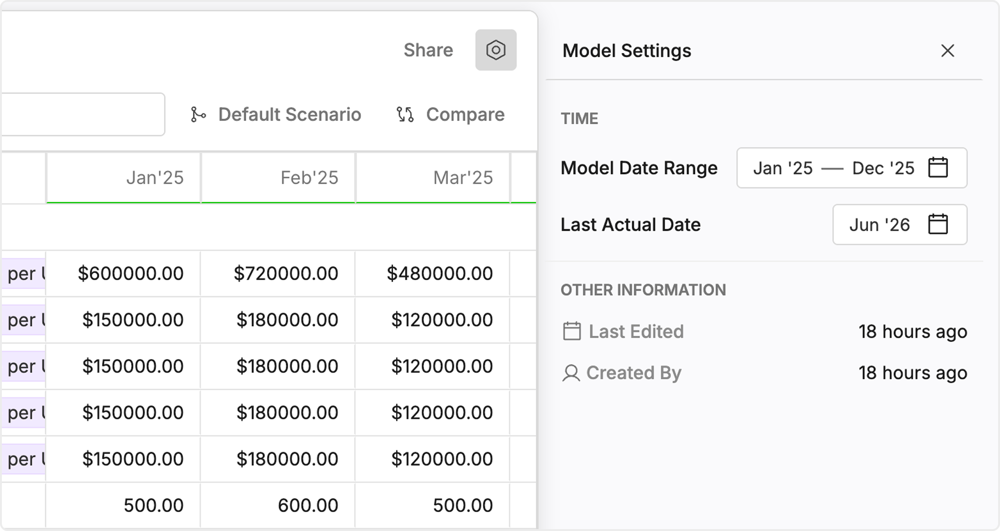

Time is one of the core systems that defines how a model behaves in Oculon. It sets the planning horizon, controls where actual logic stops, and determines how results are grouped when you review them at month, quarter, or year level.

<Frame caption="Model time settings">
  
</Frame>

The [Last actual date](/concepts/data-and-structure/time/last-actual-date) is the cutoff between actual and planned behavior. Pair it with clear actual and planned formulas so close and forecast updates stay reviewable.

## In this section

<Columns cols={2}>
  <Card title="Time in Oculon" icon="clock" href="/concepts/data-and-structure/time/time-in-oculon">
    How time settings shape formulas and reporting.
  </Card>
  <Card title="Last actual date" icon="split" href="/concepts/data-and-structure/time/last-actual-date">
    Separate actuals from planned behavior across the model.
  </Card>
  <Card title="Time granularity" icon="calendar" href="/concepts/data-and-structure/time/time-granularity">
    Choose monthly, quarterly, or yearly detail.
  </Card>
  <Card title="Relative time" icon="refresh-cw" href="/concepts/data-and-structure/time/relative-time">
    Keep formulas and filters reusable as periods move.
  </Card>
  <Card title="Time aggregation" icon="workflow" href="/concepts/data-and-structure/time/time-aggregation">
    Decide what a metric means at quarter or year level.
  </Card>
  <Card title="Time best practices" icon="badge-check" href="/concepts/data-and-structure/time/time-best-practices">
    Keep time settings consistent and easy to maintain.
  </Card>
</Columns>

## Related

- [Time rollups](/concepts/data-and-structure/time/time-aggregation) (Concepts Legacy; related to aggregation)
- [Variable behavior](/concepts/data-and-structure/variables/variable-behavior)
