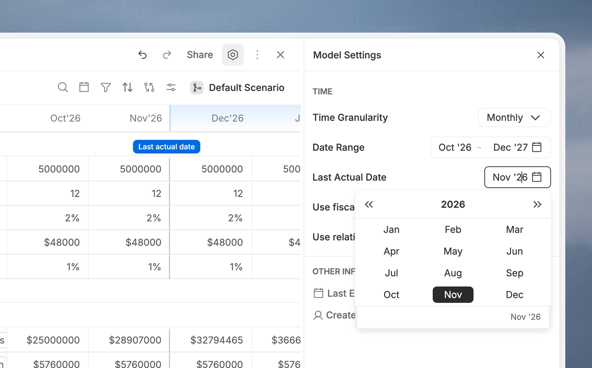

The **Last actual date** is the model setting that marks the last period with actual data. Periods up to and including it are actual periods. Later periods are planned periods. For example, with a Last actual date of `Nov '26`, October and November use actual logic and December onward uses plan logic.

<Frame caption="Choosing the Last Actual Date in Model Settings">
  
</Frame>

## How it works

You set the Last actual date in the **TIME** section of **Model Settings**, in the **Last Actual Date** field. The model grid marks that period's column header with a **Last actual Date** label.

Each variable can have two formulas:

- The **actual formula** applies to periods up to and including the Last actual date.
- The **planned formula** applies to periods after the Last actual date.

The formula editor shows these as the **Actual** and **Plan** tabs. One variable can show real history and a forecast without separate actuals and forecast copies.

## Why it matters

The Last actual date gives your team one shared cutoff for close, forecast updates, and scenario reviews. It keeps observed results and forward-looking assumptions from mixing in the same period.

## Move it forward after close

Move the Last actual date forward when a period closes. For example, after you close June, change the Last actual date from `May '25` to `Jun '25`.

When you move it forward:

- The newly closed period switches from the planned formula to the actual formula.
- The first planned period moves one period later.
- Values in that period can change, because a different formula now applies.

## Move it back

Move the Last actual date back when a period isn't final. For example, you reopen a period or correct source data.

When you move it back, the later periods switch back to their planned formulas. Comparisons that used the newer cutoff can change.

## What to check after you change it

1. Confirm the period is closed.
2. Refresh the Transactions the model reads from.
3. Review the last actual period and the first planned period.
4. Recheck the quarter and year totals your reports use.
5. Confirm scenario comparisons still use the baseline you expect.

## Related

- [Time in Oculon](/concepts/data-and-structure/time/time-in-oculon)
- [Variable behavior](/concepts/data-and-structure/variables/variable-behavior)
- [Formula basics](/concepts/modeling/formulas/formula-basics)
- [Model settings](/concepts/modeling/models/model-settings)
- [Time best practices](/concepts/data-and-structure/time/time-best-practices)
