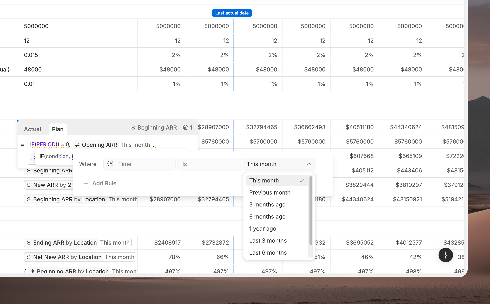
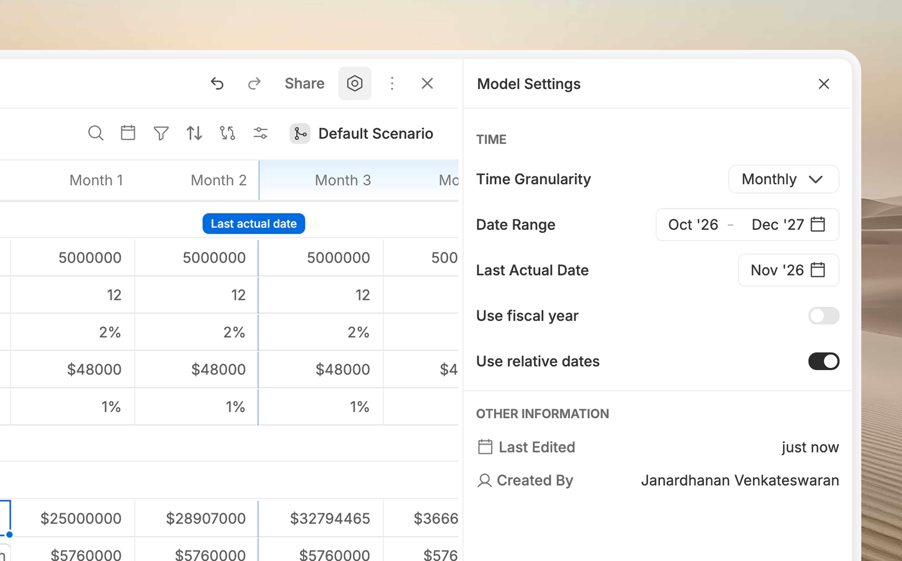

Relative time describes a period by its position relative to the current one, not by a fixed date. For example, `Units Sold` at `previous month` always means the month before the period being calculated. The same formula then works in every column of the model.

<Frame caption="Choosing a relative time reference in a formula">
  
</Frame>

## Relative time in formulas

When you add a variable to a formula, it refers to `This month` by default. Click the reference to open its rule, then choose a different period under **Where** **Time** **Is**.

The time options are:

| Option | Refers to |
| --- | --- |
| `This month` | The period being calculated |
| `Previous month` | One period earlier |
| `3 months ago` | Three periods earlier |
| `6 months ago` | Six periods earlier |
| `1 year ago` | Twelve periods earlier |
| `Last 3 months` | The three periods before the current one |
| `Last 6 months` | The six periods before the current one |
| `Last 12 months` | The twelve periods before the current one |

For example, a month-over-month growth formula can reference `Revenue` at `This month` and at `Previous month`. You never edit a date when the model moves forward.

## Relative period labels

<Frame caption="Relative period labels turned on">
  
</Frame>

The **Use relative dates** setting in **Model Settings** changes how period columns are labeled. When it's on, columns show `Month 1`, `Month 2`, and so on instead of calendar labels such as `Jan'26`. Quarterly and yearly models show `Quarter 1` or `Year 1`.

This setting only changes labels. Values and formulas stay the same. Use it for templates or plans that aren't tied to a calendar start date, such as a new-product launch plan.

## When to use relative time

Use relative time when the same rule should hold in every period:

- Growth on the previous period
- Year-over-year comparisons
- Rolling totals or averages over the last few periods
- Lagged effects, such as collections that arrive one period after billing

If you need a value from one specific, fixed period, a relative reference isn't the right fit.

## Keep it readable

- Name variables so the time offset is clear, such as `Revenue Prior Month`.
- Put complex offsets in a [helper variable](/concepts/modeling/formulas/helper-variables-and-modifiers) instead of one long formula.
- Check the first periods of the model. A reference such as `Previous month` points before the date range in the first column, so confirm the result there is what you expect.

## Related

- [Formula basics](/concepts/modeling/formulas/formula-basics)
- [Helper variables and modifiers](/concepts/modeling/formulas/helper-variables-and-modifiers)
- [Last actual date](/concepts/data-and-structure/time/last-actual-date)
- [Time granularity](/concepts/data-and-structure/time/time-granularity)
